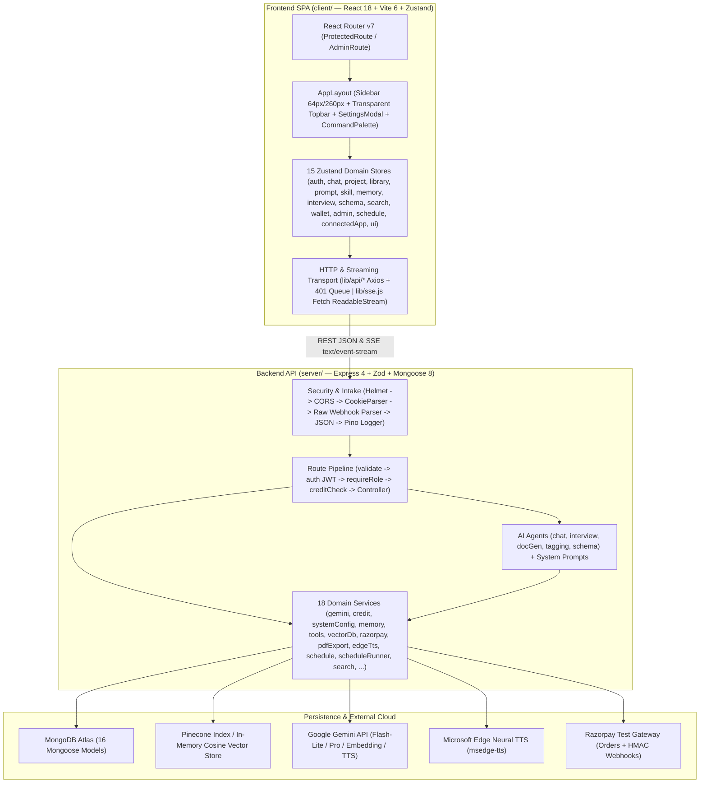

# NexAI Technical Wiki — Master Index

> **Complete Beginner-to-Advanced Engineering Documentation** generated directly from a full-repository inspection of `NexAI` (`client/`, `server/`, `.agents/`, `docs/`).

**Project Title:** NexAI — AI-Powered Personal & Developer Workspace (SaaS Edition)  
**Architecture:** JavaScript (ESM) Monorepo (`client` + `server` via npm Workspaces, Node.js `>=20.0.0`)  
**Primary AI Engine:** Google Gemini (`@google/genai`) with Hybrid Vector RAG (`@pinecone-database/pinecone` + In-Memory Cosine Fallback)  
**Billing & Governance Engine:** Token-metered Utility Credits (`ceil(totalTokens / 100)`) + Dual-Mode Quota Governance (`quota_free` vs `credit_strict`) + Razorpay Checkout & Webhooks  

---

## 1. What Is NexAI & What Problems Does It Solve?

### Beginner Overview
If you use AI daily for studying, coding, or software architecture, your work normally ends up scattered across four disconnected apps: a web chat tab, a note-taking app, code snippets in local files, and interview prep sites. On top of that, mainstream AI tools charge a flat monthly fee (~₹2,000 / \$20 per month) even if you only send a handful of prompts.

**NexAI unifies those workflows into a single personal & developer workspace metered like a public utility:**
1. **AI Chat Canvas:** Real-time streaming chat with reasoning traces (`ThinkingDrawer` & `InlineThinking`), autonomous tools (web search, URL scraper, workspace search, memory lookup, Python sandbox hint), syntax-highlighted code blocks, live Mermaid diagrams, and hands-free voice conversation.
2. **Project Workspaces:** Dedicated AI rooms with persistent custom instructions, uploaded local reference files (up to 2 MB total per project), and isolated project memory.
3. **Long-Term Memory Engine:** Automatically learns, updates, supersedes, and recalls facts about you across chats using semantic embeddings and multilingual extraction (English + Hindi/Hinglish).
4. **Consolidated Knowledge Library:** One searchable hub for web links (Cheerio-extracted), rich markdown notes, code snippets, uploaded PDFs/files, AI-drafted structured documents (exported to styled PDFs via `pdf-lib`), and archived mock interview reports—strictly following **Suggest → Review → Confirm** so AI never silently corrupts your database.
5. **AI Mock Interview & Viva Arena:** Voice-enabled technical interviewer with interactive `VoiceRipple` animation, Microsoft Edge Neural TTS (`msedge-tts`) + Gemini 3.8 Flash-Lite TTS + Web Speech API fallback, 5-question benchmark tracking, and automated 0–100 competency scorecards.
6. **Skills, Prompt Vault & Automations Engine:** Parameterized `{{variable}}` templates, tool-augmented `/` & `@` slash skills, background cron-like schedule runner (60s interval worker), and connected external app credentials.
7. **ER Diagram / Data Modeling Studio:** Interactive visual canvas + live two-way synced Eraser-style ER DSL (`users.id < posts.userId`), PostgreSQL DDL & Prisma exporters, plus canonical IR linting and topological seed-data modules.
8. **Utility Wallet, Razorpay Billing & Admin Telemetry:** Server-authoritative plans, HMAC-SHA256 + idempotent webhook payment ledger, and role-gated `/admin` analytics tracking live Google Gemini RPD/RPM/TPM quotas.

---

## 2. High-Level System Blueprint



---

## 3. Wiki Navigation & Reading Order

| # | Wiki Page | Best For | What You Will Learn |
| :--- | :--- | :--- | :--- |
| **01** | [Architecture & Request Lifecycle](./01-Architecture-and-Request-Lifecycle.md) | Everyone | Monorepo layering, Express boot sequence, middleware order, Dual-Mode Governance, atomic credit deduction, error logging. |
| **02** | [Tech Stack, Libraries & Design System](./02-Tech-Stack-Libraries-and-Design-System.md) | Frontend / Full-Stack | Every npm dependency, Vite PWA & Workbox caching, 2-tier SCSS design tokens, dark/light themes, 23 UI primitives, 6 common components, 6 custom hooks. |
| **03** | [Data Models & Database Architecture](./03-Data-Models-and-Database-Architecture.md) | Backend / Viva | Full ER diagram of all 16 Mongoose models, indexes, hooks, transforms, `Prompt`/`Skill` alias, and schema nuances. |
| **04** | [Authentication & Security](./04-Authentication-and-Security.md) | Security / Backend | Dual-token JWT flow, Google OAuth, Axios 401 retry queue, RBAC, rate limits, Zod validation, `userId` isolation, HMAC webhook security. |
| **05** | [Chat, SSE Streaming, Tools & Voice Mode](./05-Chat-Streaming-Tools-and-Voice.md) | Core Product | `ChatHero`, `ChatInput`, multi-attachments, 4-loop `chat.agent.js`, 3-tier web search, `MermaidBlock`, `PromptBlock`, hands-free voice loop, `chatSimulator.js`. |
| **06** | [Memory, Personalization & Project Workspaces](./06-Memory-Personalization-and-Projects.md) | AI Engineering | Cross-chat `Memory` lifecycle, EN+Hinglish regex + Gemini reconciliation, `validTo`/`supersededBy`, weighted retrieval formula, 2 MB Project Workspaces. |
| **07** | [Knowledge Library, Vector RAG & PDF Engine](./07-Knowledge-Library-RAG-and-PDF.md) | RAG / Data | Suggest → Review → Confirm flow, Cheerio scraping, 3,000-char multi-chunk vector indexing, `docGen.agent`, server `pdf-lib` pagination. |
| **08** | [Skills, Prompt Vault, Automations & Connected Apps](./08-Skills-Prompts-and-Automations.md) | Power Users | `{{variable}}` extraction, slash `@`/`/` skills, system skills seeder, 60s `scheduleRunner`, Connected Apps, unmounted router caveats. |
| **09** | [AI Mock Interview & Viva Platform](./09-AI-Mock-Interview-Platform.md) | Students / Viva | `InterviewSetup`, `InterviewArena`, `VoiceRipple`, 5-turn progress, Edge vs Gemini TTS 3-tier fallback, trivial-session guard, Library archival. |
| **10** | [Data Modeling & ER Diagram Studio](./10-Data-Modeling-and-Schema-Designer.md) | Architects / Devs | Dual architecture: active Eraser DSL (`erLang.js` + `VisualErdCanvas` + `CodeEditorPanel`) + canonical IR v1 (`schemaIR`, `schemaLinter`, `schemaSeed`, `schemaSync`), plus backend schema agent nuance. |
| **11** | [Unified Hybrid Search & Command Palette](./11-Unified-Search-and-Command-Palette.md) | UX / Search | `search.service.js` hybrid ranking across Library/Prompts/Chats, `/search` bulk management, `Ctrl+K` `CommandPalette`. |
| **12** | [Wallet, Razorpay Billing & Admin Telemetry](./12-Wallet-Billing-and-Admin-Telemetry.md) | SaaS / Examiners | Server `PLANS`, Razorpay checkout/QR simulation, webhook idempotency (`E11000`), `SystemConfig` governance toggle, Admin Recharts & RPD/RPM/TPM telemetry. |
| **13** | [AI Prompts, Rules & Agent Engineering](./13-AI-Prompts-Rules-and-Agent-Engineering.md) | Prompt Engineers | Exact anatomy of all 6 prompt modules, agent configs, starter prompts, `.agents/rules/nexaiworkspace.md`, and ADR governance. |
| **14** | [API Reference, Testing, CI/CD & Deployment](./14-API-Reference-Testing-and-Deployment.md) | QA / DevOps | Complete endpoint table across all 17 routers + webhooks, 70 test suites (434 cases), ESLint/Prettier, Render/Vercel configs, seminar scripts & codebase audit notes. |

### Recommended Tracks
- **Fast Viva / Examiner Prep (20 mins):** Read **01** → **03** → **05** → **09** → **12** → **13**.
- **Frontend Contributor:** Read **01** → **02** → **05** → **08** → **10** → **11**.
- **Backend / AI Engineer:** Read **01** → **03** → **04** → **06** → **07** → **13** → **14**.

---

## 4. Feature Status & Routing Matrix (Verified Against Live Code)

| Feature | Frontend Route(s) | Primary Page / Entry | Zustand Store(s) | Backend Base Route(s) | Live Wiring Status |
| :--- | :--- | :--- | :--- | :--- | :--- |
| **Authentication** | `/login`, `/register` | `LoginPage`, `RegisterPage` | `useAuthStore` | `/api/auth/*` | Fully wired |
| **AI Chat & Voice** | `/` (`ROUTES.HOME`), `/chat`, `/chat/:chatId` | `ChatPage` | `useChatStore` | `/api/chats/*` | Fully wired (`isTemporary` & `isSimulation` supported) |
| **Project Workspaces** | `/projects`, `/projects/:projectId` | `ProjectsGalleryPage`, `ProjectPage` | `useProjectStore` | `/api/projects/*` | Fully wired (2 MB capacity tracking, 50k chars/source injection) |
| **Consolidated Library** | `/library`, `/documents`, `/documents/:id` | `LibraryPage`, `DocumentsPage` | `useLibraryStore` | `/api/library/*` | Fully wired (Note: `/documents` renders `<LibraryPage defaultTab="documents" />`) |
| **Prompt Vault** | `/prompts` | `PromptsPage` | `usePromptStore` | `/api/prompts/*` | Fully wired (shares MongoDB `skills` collection via `Prompt = Skill`) |
| **AI Mock Interview** | `/interview` | `InterviewPage` | `useInterviewStore` | `/api/interview/*` | Fully wired (Edge TTS + Gemini TTS + Web Speech fallback) |
| **ER Diagram Studio** | `/schema`, `/schema-designer` | `SchemaPage` | `useSchemaStore` | `/api/schemas/generate` | UI & Eraser DSL live; live backend Gemini schema agent has config param mismatch causing fallback simulation (see [Page 10](./10-Data-Modeling-and-Schema-Designer.md)) |
| **Unified Search** | `/search` + `Ctrl+K` modal | `SearchPage`, `CommandPalette` | `useSearchStore` | `/api/search` | Fully wired |
| **Wallet & Billing** | `/wallet` (+ inside `SettingsModal`) | `WalletPage` | `useWalletStore` | `/api/wallet/*`, `/api/webhooks/razorpay` | Fully wired |
| **Settings & Memory** | `/settings` + global `SettingsModal` | `SettingsPage`, `SettingsModal`, `MemoryManager` | `useAuthStore`, `useMemoryStore`, `useUiStore` | `/api/users/me/settings`, `/api/memories/*` | Fully wired (Sidebar footer opens `SettingsModal` directly) |
| **Admin Telemetry** | `/admin` (`AdminRoute`) | `AdminPage` | `useAdminStore` | `/api/admin/*` | Fully wired (Role-gated `admin`) |
| **Design System** | `/design-system` | `DesignSystemPage` | `useUiStore` | — | Live in development/direct URL |
| **Skills Hub** | Defined as `ROUTES.SKILLS = '/skills'` | `SkillsPage` + Sidebar nav item | `useSkillStore` | `/api/skills/*` | **Partial / Unmounted in `router/index.jsx`:** `/` & `+` menu inside Chat work cleanly via `SlashSkillsPopover` & `SkillPickerModal`, but navigating to `/skills` hits `NotFoundPage` (see [Page 08](./08-Skills-Prompts-and-Automations.md)) |
| **Automations Hub** | Defined as `ROUTES.AUTOMATIONS = '/automations'` | `AutomationsPage` (imported in `router/index.jsx`) | `useScheduleStore`, `useConnectedAppStore` | `/api/schedules/*`, `/api/connected-apps/*` | **Partial / Unmounted in `router/index.jsx`:** Backend routes & 60s `scheduleRunner` run automatically, but `/automations` route is not mounted in `appChildren` (see [Page 08](./08-Skills-Prompts-and-Automations.md)) |

---

## 5. Monorepo Structure Overview

```text
NexAI/
├── .agents/rules/nexaiworkspace.md   # Workspace coding & architectural rules
├── .editorconfig / .prettierrc / .nvmrc
├── package.json                      # Root npm workspace ("nexai-monorepo")
├── render.yaml                       # Render backend deployment config
├── build_seminar_presentation.py     # Generates 15-slide MSBTE PPTX + HTML
├── presentation.html                 # Browser seminar deck
├── client/                           # React 18 + Vite 6 + PWA + SCSS Modules + Zustand
│   ├── index.html
│   ├── vercel.json                   # SPA rewrite for Vercel Hosting
│   ├── vite.config.js                # @ alias, /api proxy, Workbox PWA config
│   ├── eslint.config.js
│   └── src/
│       ├── main.jsx / App.jsx
│       ├── router/                   # BrowserRouter + ProtectedRoute + AdminRoute
│       ├── constants/                # routes.js, starterPrompts.js
│       ├── hooks/                    # 6 reusable hooks
│       ├── lib/                      # api/ (15 modules), sse.js, utils/ (5 utilities)
│       ├── store/                    # 15 Zustand stores
│       ├── styles/                   # tokens/, themes/ (_dark, _light), abstracts/, base/
│       ├── components/               # ui/ (23 primitives) & common/ (6 shared widgets)
│       ├── layouts/                  # AppLayout (Sidebar, Topbar), AuthLayout
│       ├── features/                 # 12 domain feature folders
│       └── pages/                    # 18 page files (16 directories + DesignSystemPage)
├── server/                           # Node.js >=20 + Express 4 + Mongoose 8 + Zod 3
│   ├── eslint.config.js
│   ├── .env.example
│   ├── src/
│   │   ├── server.js                 # Process bootstrap & startup hooks
│   │   ├── app.js                    # Express middleware pipeline & error boundary
│   │   ├── config/                   # env.js, db.js, gemini.js, pinecone.js, plans.js
│   │   ├── middleware/               # auth, creditCheck, errorHandler, requestLogger, requireRole, validate
│   │   ├── models/                   # 16 Mongoose models (15 collections + Prompt alias)
│   │   ├── routes/                   # 17 route files + index.js
│   │   ├── validators/               # 14 Zod validation modules
│   │   ├── controllers/              # 17 thin controllers
│   │   ├── services/                 # 18 domain services
│   │   ├── agents/                   # 5 AI agents + 6 system prompt modules
│   │   ├── utils/                    # ApiError, asyncHandler, sse, token, logger, chatSimulator
│   │   └── scripts/                  # seedAdmin.js, testE2EStreaming.js
│   └── tests/                        # 18 Vitest + Supertest integration/unit suites
└── docs/                             # PRD, BUILD_GUIDE, AGENT_PLAYBOOK, MASTER_CHANGES_SPEC,
                                      # decisions.md, api.md, viva-prep.md, ABSTRACT, wiki/
```

---

## 6. Quick Start (Local Development)

1. **Prerequisites:** Node.js `>=20.0.0` (`.nvmrc` specifies `20`), MongoDB instance (`MONGODB_URI`), and optional Google Gemini / Pinecone / Razorpay / Google OAuth credentials.
2. **Environment Configuration:**
   - Copy `server/.env.example` → `server/.env` and set `MONGODB_URI`, `JWT_ACCESS_SECRET`, `JWT_REFRESH_SECRET` (required at startup by `server/src/config/env.js`), plus `GEMINI_API_KEY` for live AI generation.
   - Copy `client/.env.example` → `client/.env` (`VITE_API_URL=/api`, optional `VITE_GOOGLE_CLIENT_ID`, `VITE_RAZORPAY_KEY_ID`).
3. **Install & Seed Admin:**
   ```bash
   npm install
   npm run dev --workspace=server   # or node server/src/scripts/seedAdmin.js (after configuring ADMIN_EMAIL / ADMIN_PASSWORD)
   ```
4. **Run Both Client & Server:**
   ```bash
   npm run dev                      # runs server (:5000) and Vite client (:5173) via concurrently
   npm run lint                     # runs ESLint in both workspaces
   npm run test                     # runs Vitest across server (18 files) and client (52 files)
   ```

---

## 7. Core Glossary

| Term | Definition in NexAI |
| :--- | :--- |
| **Credit Metering** | Converting actual LLM token usage into credits via `Math.ceil(totalTokens / 100) * CREDITS_PER_100_TOKENS` (`server/src/services/credit.service.js`). |
| **Dual-Mode Governance** | Runtime platform toggle in `SystemConfig` (`billingEnforcementMode`): `'quota_free'` allows 0-credit execution up to `dailyGeminiQuotaLimit` (1,500 RPD), while `'credit_strict'` blocks with HTTP `402`. |
| **Suggest → Review → Confirm** | Human-in-the-loop pattern requiring users to inspect and approve AI-generated library summaries, tags, documents, or schemas before saving to MongoDB. |
| **SSE (`text/event-stream`)** | Unidirectional HTTP streaming over `fetch` + `ReadableStream` (`client/src/lib/sse.js`) emitting `step`, `grounding`, `thought`, `token`, `memory_updated`, `done`, and `error` events. |
| **Canonical IR vs Eraser DSL** | Two schema representations in `client/src/features/schemaDesigner/`: active Eraser text DSL (`erLang.js`) used by the `/schema` studio, and Version-1 Canonical IR (`schemaIR.js`) powering linting, seed generation, and multi-dialect export helpers. |
| **Temporal Memory Superseding** | Instead of deleting outdated facts, `Memory` marks older records `active: false`, `validTo: Date`, and links `supersededBy` to the newer `Memory` document. |
| **Simulation Mode** | Deterministic offline/demo execution (`isSimulation: true` or `x-simulation: true`) powered by `chatSimulator.js` and simulated interview/payment paths that consume `0` credits and bypass `creditCheck`. |
