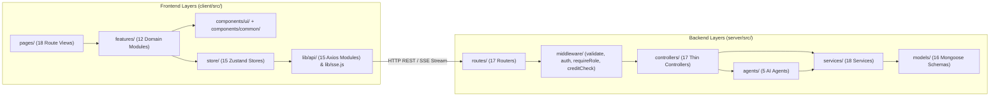
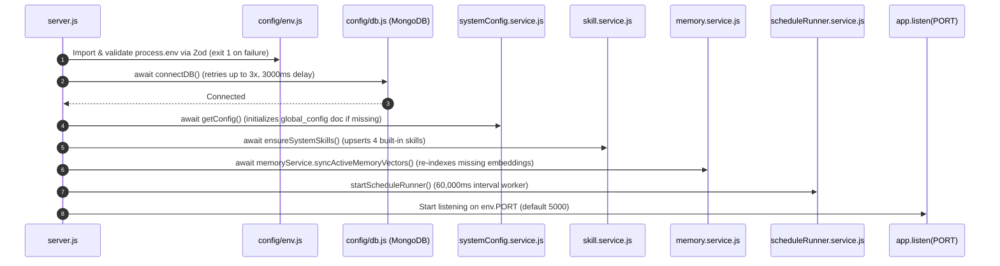
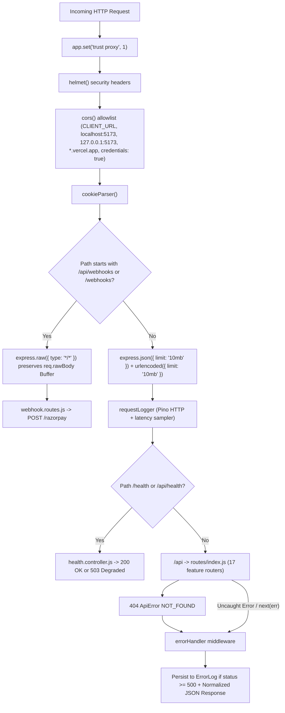
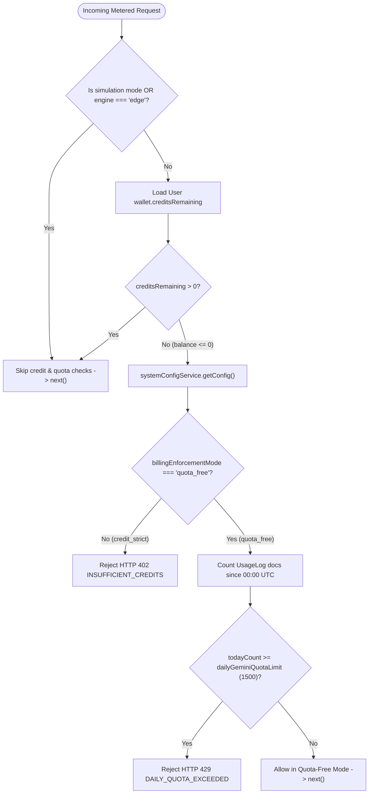
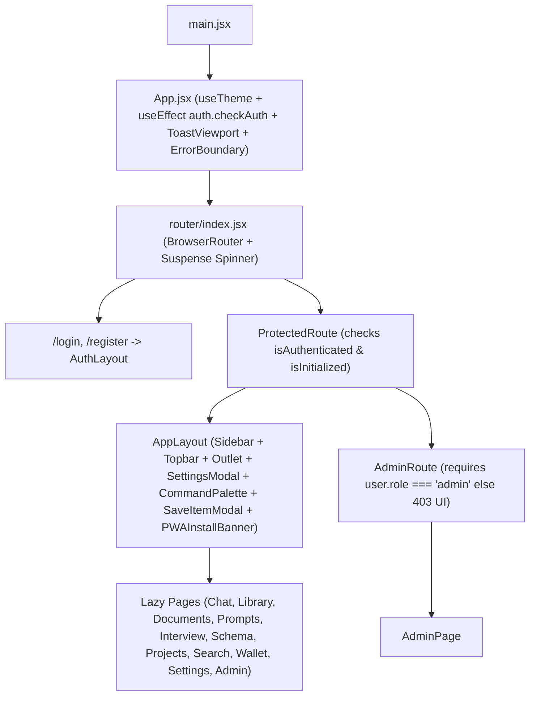

# 01 — System Architecture & Request Lifecycle

This page explains NexAI's structural boundaries, server boot pipeline, Express middleware chain, Dual-Mode Governance engine, atomic credit deduction, and client-to-server lifecycle.

---

## 1. Monorepo & Layering Contract

NexAI is organized as an **npm workspaces monorepo** (`package.json` at repository root) containing two ESM (`"type": "module"`) packages:
- **`client/`** — React 18 Single Page Application built with Vite 6, custom SCSS Modules + semantic design tokens, React Router 7, Axios, and 15 Zustand stores.
- **`server/`** — Node.js `>=20` Express 4 REST + SSE server backed by MongoDB (`mongoose`), Pinecone/in-memory vectors, Google Gemini (`@google/genai`), Edge Neural TTS (`msedge-tts`), `pdf-lib`, and Razorpay.

Both workspaces enforce a strict unidirectional dependency chain (codified in `docs/BUILD_GUIDE.md` and `.agents/rules/nexaiworkspace.md`):



### Key Architectural Constraints
1. **No client secrets:** Gemini keys, Pinecone keys, JWT secrets, and Razorpay secrets live exclusively on `server/`.
2. **Thin controllers, service logic:** Controllers (`server/src/controllers/*.js`) extract validated inputs, coordinate responses or SSE streams, and delegate business logic to `services/` and `agents/`.
3. **No raw `axios` in React components:** Components call Zustand store actions, which call `client/src/lib/api/*.api.js` or `client/src/lib/sse.js`.
4. **Suggest → Review → Confirm:** AI outputs (library tags/summaries, drafted structured documents, generated ER schemas) return as unpersisted drafts until explicitly saved by the user.

---

## 2. Server Bootstrap Sequence (`server/src/server.js`)

When `npm run dev` or `npm start` launches `server/src/server.js`, five initialization steps execute in strict order before accepting HTTP traffic:



### Graceful Shutdown & Crash Guards
`server/src/server.js` registers handlers for `SIGINT`, `SIGTERM`, `unhandledRejection`, and `uncaughtException`:
- On `SIGINT` / `SIGTERM`: stops the background scheduler (`stopScheduleRunner()`), closes the HTTP server, logs closure, and exits `0`.
- On unhandled promise rejections or uncaught exceptions: logs via Pino (`logger.error`/`fatal`), stops the scheduler, and shuts down cleanly (`process.exit(1)`).

---

## 3. Environment Validation (`server/src/config/env.js`)

Before Express loads any route, `config/env.js` runs `dotenv.config()` and validates `process.env` using Zod (`envSchema.safeParse`). If any required variable is missing or malformed, the server logs formatted Zod errors and exits with code `1`.

| Variable | Default / Validation | Purpose |
| :--- | :--- | :--- |
| `NODE_ENV` | `'development' \| 'production' \| 'test'` (`'development'`) | Controls cookies, error stack exposure, rate-limit skipping, credit mode default. |
| `PORT` | Coerced number (`5000`) | HTTP listen port. |
| `CLIENT_URL` | Valid URL (`'http://localhost:5173'`) | CORS origin allowlist entry. |
| `MONGODB_URI` | Required non-empty string | Primary MongoDB connection URI (`connectDB()` overrides with `MONGODB_URI_TEST` when `NODE_ENV === 'test'`). |
| `MONGODB_URI_TEST` | Optional string | Isolated test database URI used by `connectDB()` in Vitest. |
| `JWT_ACCESS_SECRET` | Required non-empty string | Signs 15-minute Bearer access tokens. |
| `JWT_REFRESH_SECRET` | Required non-empty string | Signs 7-day `httpOnly` refresh cookies. |
| `GOOGLE_CLIENT_ID` | Optional string | Verifies Google Identity ID tokens via `google-auth-library`. |
| `GEMINI_API_KEY` | Optional string | Authenticates `@google/genai` client (`config/gemini.js`). |
| `GEMINI_FLASH_MODEL` | `'gemini-3.5-flash-lite'` | Default fast conversational, tagging, memory, doc-gen, and schema model. |
| `GEMINI_PRO_MODEL` | `'gemini-3.1-pro-preview'` | High-reasoning tier model. |
| `GEMINI_EMBED_MODEL` | `'gemini-embedding-001'` | Vector embedding model (`gemini.service.js` `embedContent`). |
| `GEMINI_TTS_MODEL` | `'gemini-3.8-flash-lite-tts'` | Cloud neural WAV audio synthesis model. |
| `CREDITS_PER_100_TOKENS` | Coerced number (`1`) | Multiplier for `Math.ceil(tokens / 100)`. |
| `CREDIT_ENFORCEMENT_MODE` | `'quota_free'` (or `'credit_strict'` in `test`) | Initial fallback mode before `SystemConfig` is toggled by an admin. |
| `STARTER_CREDITS` | Coerced number (`100`) | Credits granted to new email/Google registrants (`auth.service.js`). |
| `PINECONE_API_KEY` / `PINECONE_INDEX` | Optional strings (`nexai` in `.env.example`) | Enables remote Pinecone vector storage (`config/pinecone.js`). |
| `RAZORPAY_KEY_ID` / `RAZORPAY_KEY_SECRET` / `RAZORPAY_WEBHOOK_SECRET` | Optional strings | Order creation and HMAC SHA-256 verification. |
| `ADMIN_EMAIL` / `ADMIN_PASSWORD` | Optional email & string | Used by `server/src/scripts/seedAdmin.js`. |

> **Nuance to note (`gemini.service.js` vs `env.js`):** If env overrides are omitted in code-level helpers, `gemini.service.js` has internal fallback constants `'gemini-3.1-flash-lite'` (for Flash/failover) and `'text-embedding-004'` (if `GEMINI_EMBED_MODEL` is unset), whereas `env.js` populates Zod defaults `'gemini-3.5-flash-lite'` and `'gemini-embedding-001'`.

---

## 4. Express Middleware Pipeline (`server/src/app.js`)

Middleware ordering in `server/src/app.js` is deliberate—especially for webhook cryptography and error logging:



### Why Raw Body Parsing Comes Before `express.json()`
Razorpay signs webhooks against the exact raw UTF-8 request bytes. If `express.json()` runs first and re-serializes whitespace or key ordering, `HMAC-SHA256(rawBody, RAZORPAY_WEBHOOK_SECRET)` fails verification. Mounting `express.raw({ type: '*/*' })` strictly before `express.json()` preserves `req.body` as a `Buffer` (also copied to `req.rawBody` inside `webhook.controller.js`).

### Normalized Success & Error Contracts
- **Success (`controllers/*.js`):** `{ data, meta? }` (Note: `interview.controller.js` returns legacy top-level shapes such as `{ session, creditsDeducted }` or `{ interviews }` for historical compatibility—detailed in [Page 14](./14-API-Reference-Testing-and-Deployment.md)).
- **Error (`middleware/errorHandler.js`):**
  ```json
  {
    "error": {
      "code": "STRING_CODE",
      "message": "Human-readable description",
      "details": null
    }
  }
  ```
- **Error Categorization in `errorHandler.js`:**
  - `ApiError` instances preserve `.statusCode`, `.code`, `.details`.
  - Mongoose `ValidationError` → `400 VALIDATION_ERROR`.
  - Mongoose duplicate key `11000` → `409 DUPLICATE_ERROR`.
  - Mongoose `CastError` → `400 INVALID_ID`.
  - `JsonWebTokenError` / `TokenExpiredError` → `401 INVALID_TOKEN` / `401 TOKEN_EXPIRED`.
  - Unhandled errors (`status >= 500`) trigger non-blocking `ErrorLog.create(...)` persistence, sanitizing stack traces in `production`.

### Request Latency & Telemetry (`middleware/requestLogger.js`)
Every API request captures `Date.now()` before proceeding and hooks `res.on('finish')` to push latency samples (`durationMs = Date.now() - start`) into a circular in-memory buffer (`MAX_LATENCY_SAMPLES = 200`), feeding `getAverageLatency()` on the Admin Dashboard (`GET /api/admin/stats`).

---

## 5. Dual-Mode Credit Metering & Quota Governance

Every metered AI endpoint (`chat`, `library/suggest`, `library/documents/generate`, `interview/start`, `interview/:id/respond`, `interview/:id/conclude`, `interview/tts`, `schemas/generate`, plus background `executeSchedule`) uses two interlocking components: **Pre-flight Gatekeeping (`creditCheck.js`)** and **Atomic Post-Call Deduction (`credit.service.js`)**.



### Atomic Credit Deduction Formula (`credit.service.js`)
After Gemini responds (or completes SSE streaming) with `usageMetadata`:
1. **Conversion rule:**
   $$\text{creditsToDeduct} = \left\lceil \frac{\text{tokensUsed}}{100} \right\rceil \times \text{CREDITS\_PER\_100\_TOKENS}$$
   Implemented as `Math.ceil(tokens / 100) * (env.CREDITS_PER_100_TOKENS || 1)`, returning `0` when `tokens <= 0`.
2. **Atomic floor-safe update:** Uses MongoDB aggregation-pipeline update (`$set` with `$max` and `$subtract` + `$add`) on `User.findOneAndUpdate`:
   - `wallet.creditsRemaining`: `{ $max: [0, { $subtract: ['$wallet.creditsRemaining', creditsToDeduct] }] }`
   - `wallet.totalTokensConsumed`: `{ $add: ['$wallet.totalTokensConsumed', Math.max(0, tokensUsed)] }`
   Because this executes as a single atomic WiredTiger document write, concurrent requests cannot push `creditsRemaining` below `0` even in `quota_free` mode.
3. **Audit Log:** Inserts a `UsageLog` record `{ userId, model, feature, tokensUsed, creditsDeducted }`, which powers the Admin usage charts and daily RPD/RPM/TPM telemetry.

---

## 6. Frontend Application Lifecycle (`client/src/`)



### Network & Streaming Clients (`client/src/lib/`)
- **REST Client (`lib/api/client.js`):** Single Axios instance (`baseURL = VITE_API_URL || '/api'`, `withCredentials: true`, `timeout: 30000`) divided across 15 domain files (`auth`, `chat`, `library`, `project`, `prompt`, `skill`, `schedule`, `connectedApp`, `interview`, `memory`, `schema`, `search`, `wallet`, `admin`, plus `client.js`). The response interceptor unwraps `response.data` automatically, handles `401` refresh queues, and normalizes errors into `{ code, message, details, status }`.
- **SSE Client (`lib/sse.js`):** Standard browser `EventSource` only supports `GET` and cannot attach custom `Authorization: Bearer` headers or JSON payloads. Instead, `streamChatMessage()` and `streamInterviewResponse()` call native `fetch` with `AbortController.signal` and parse `text/event-stream` lines incrementally via `ReadableStream` (`TextDecoder`, handling split network packets, CRLF `\r\n`, and SSE comments). Errors such as HTTP `402` or nested JSON Gemini errors are sanitized cleanly via `sanitizeErrorMessage()`.
