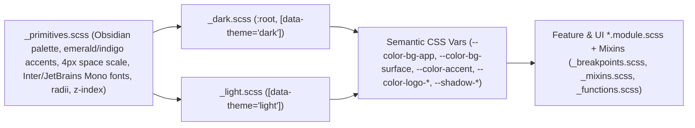

# 02 — Tech Stack, Libraries & Design System

This page catalogs every dependency across the NexAI monorepo (`client`, `server`, root workspace), explains the engineering trade-offs behind each library choice, and documents the custom SCSS 2-tier design token architecture, PWA caching strategy, UI primitives, common components, and custom React hooks.

---

## 1. Root Monorepo Tooling (`package.json`)

| Config / Package | Version / Value | Purpose |
| :--- | :--- | :--- |
| `engines.node` | `>=20.0.0` (`.nvmrc`: `20`) | Required Node.js runtime with native ESM & Fetch/WebStreams support. |
| `workspaces` | `["client", "server"]` | Native npm workspaces managing both apps without Turborepo/Lerna overhead. |
| `concurrently` | `^9.1.2` | Launches `server` (blue) and `client` (green) together via `npm run dev`. |
| `prettier` | `^3.5.3` | Consistent code formatting (`.prettierrc`: `semi: true`, `singleQuote: true`, `tabWidth: 2`, `trailingComma: "all"`, `printWidth: 100`, `endOfLine: "lf"`). |
| `.editorconfig` | UTF-8, LF, 2 spaces | Editor indentation hygiene; preserves trailing whitespace in `*.md`. |

---

## 2. Backend Libraries (`server/package.json`)

| Package | Version | Role in NexAI & Architectural Rationale |
| :--- | :--- | :--- |
| **`express`** | `^4.21.2` | Core HTTP REST + SSE server framework (`app.js`). |
| **`mongoose`** | `^8.9.5` | MongoDB ODM powering 16 model files, `$text` indexes, compound tenant indexes, and atomic aggregation updates. |
| **`@google/genai`** | `^2.24.0` | Official Google Gemini SDK. Chosen directly over LangChain/LlamaIndex to avoid heavy transitive bloat and slow Render cold starts. Supports `generateContent`, `generateContentStream`, `embedContent`, and Gemini TTS audio synthesis. |
| **`@pinecone-database/pinecone`** | `^9.0.0` | Managed serverless vector database client used behind the provider-agnostic `vectorDb.service.js` abstraction (falls back to in-memory cosine similarity when keys are unset). |
| **`pdf-lib`** | `^1.17.1` | Pure JavaScript PDF generator (`pdfExport.service.js`). Chosen deliberately over Puppeteer/headless Chrome because Render's free tier (512 MB RAM) cannot sustain Chromium processes. |
| **`msedge-tts`** | `^2.1.0` | Streams 24 kHz 96 kbps mono MP3 neural speech (`edgeTts.service.js`) in ~400 ms at $0 cost and zero Gemini RPD quota burn. |
| **`cheerio`** | `^1.2.0` | Server-side HTML DOM parser (`linkExtractor.service.js`, `tools.service.js`) used to extract article text and parse DuckDuckGo/Bing HTML search results. |
| **`jsonwebtoken`** | `^9.0.3` | Mints & verifies dual JWTs (`15m` access token, `7d` refresh cookie). |
| **`bcryptjs`** | `^3.0.3` | Pure-JS password hashing (`saltRounds = 12` in `auth.service.js`), avoiding native C++ build issues on cloud hosts. |
| **`google-auth-library`** | `^11.1.0` | Verifies Google OAuth Sign-In ID tokens (`OAuth2Client.verifyIdToken`). |
| **`zod`** | `^3.24.1` | Runtime schema validation for startup env (`config/env.js`), request payloads (`middleware/validate.js`), and AI JSON responses (`docGen.agent.js`, `interview.agent.js`). |
| **`helmet`** | `^8.0.0` | Sets security HTTP response headers. |
| **`cors`** | `^2.8.5` | Strict credentialed origin allowlist (`CLIENT_URL`, localhost `5173`, `*.vercel.app`). |
| **`cookie-parser`** | `^1.4.7` | Parses `refreshToken` `httpOnly` cookie on `/api/auth/refresh`. |
| **`express-rate-limit`** | `^7.5.0` | Protects auth (30/15m) and AI endpoints (30/1m) against brute-force and quota exhaustion. |
| **`dotenv`** | `^16.4.7` | Loads `.env` before Zod validation runs. |
| **`pino` / `pino-http`** | `^9.6.0` / `^10.4.0` | High-speed structured JSON logger + HTTP request latency tracking (`utils/logger.js`, `middleware/requestLogger.js`). |
| **Dev Tools** | `eslint ^9.19.0`, `@eslint/js ^9.19.0`, `globals ^15.14.0`, `nodemon ^3.1.9`, `vitest ^3.0.4`, `supertest ^7.0.0` | Flat ESLint 9 config + Vitest/Supertest API integration test runner. |

---

## 3. Frontend Libraries & PWA Configuration (`client/package.json` & `vite.config.js`)

| Package | Version | Role in NexAI & Key Features |
| :--- | :--- | :--- |
| **`react` / `react-dom`** | `^18.3.1` | Component UI runtime (`StrictMode`, `React.lazy`, `Suspense`, `createPortal`). |
| **`react-router-dom`** | `^7.1.5` | Client-side `BrowserRouter` SPA routing with `ProtectedRoute` and `AdminRoute` wrappers. |
| **`zustand`** | `^5.0.3` | Minimal, hook-free + hook-driven global state across **15 domain stores** (`useChatStore`, `useAuthStore`, etc., supporting outside-React reads via `.getState()`). |
| **`axios`** | `^1.7.9` | HTTP client with request Bearer injection, `withCredentials: true`, response data unwrapping, and transparent `401` retry queues (`lib/api/client.js`). |
| **`sass`** | `^1.83.4` | CSS Modules (`*.module.scss`) compiled with Vite `api: 'modern-compiler'` and `@` alias pointing to `./src`. |
| **`clsx`** | `^2.1.1` | Lightweight conditional class utility wrapped by `lib/utils/cn.js`. |
| **`lucide-react`** | `^0.475.0` | Clean SVG icon set used uniformly across navigation, chat composer, schema canvas, and modals. |
| **`react-markdown` + `remark-gfm`** | `^10.1.0` + `^4.0.1` | Renders assistant answers, tables (via custom `tableNormalizer.js`), code blocks, file trees, `prompt` cards, and `mermaid` blocks. |
| **`prismjs`** | `^1.30.0` | Syntax highlighting for `CodeBlock`, `SnippetEditor`, `CodeInspector`, and a custom `Prism.languages.er` grammar inside `CodeEditorPanel`. |
| **`mermaid`** | `^12.1.0` | Client-side interactive SVG diagram rendering inside chat (`MermaidBlock`, debounced during streaming + pan/zoom `DiagramLightbox`). |
| **`recharts`** | `^3.10.1` | Responsive SVG charts on `/admin` (`UsageChart` area chart + `ModelSplitChart` donut chart). |
| **`@react-oauth/google`** | `^0.13.5` | Renders the Google One-Tap / Sign-In button delivering credential ID tokens to `/api/auth/google`. |
| **`vite-plugin-pwa`** (devDep) | `^2.0.0` | Generates PWA manifest & Workbox service worker (`registerType: 'autoUpdate'`, `standalone` display, `#121214` theme). |
| **Test & Lint** | `vitest ^3.0.4`, `jsdom ^26.0.0`, `@testing-library/react ^16.2.0`, `@testing-library/jest-dom ^6.6.3`, `eslint ^9.19.0`, `vite ^6.1.0` | Unit + component test suite and React Hooks/Refresh ESLint enforcement. |

### Vite PWA & Runtime Caching (`client/vite.config.js`)
Workbox pre-caches static build assets (`**/*.{js,css,html,ico,png,svg,webp,woff,woff2}`) and configures three runtime caches:
- **Google Fonts CSS** (`fonts.googleapis.com`): `CacheFirst` (365 days, max 10 entries).
- **Google Font Files** (`fonts.gstatic.com`): `CacheFirst` (365 days, max 20 entries).
- **Images** (`png|jpg|jpeg|svg|gif|webp`): `StaleWhileRevalidate` (30 days, max 50 entries).

---

## 4. Custom 2-Layer Design System (`client/src/styles/`)

NexAI explicitly avoids Tailwind CSS, MUI, or Chakra UI in favor of **SCSS Modules powered by CSS Custom Properties**. Components **never** hard-code hex values, pixel spacing, or fonts directly; instead they reference semantic tokens that swap instantaneously when `document.documentElement.dataset.theme` toggles between `'dark'` (default) and `'light'`.

### Key Token Categories (`_primitives.scss`, `_dark.scss`, `_light.scss`, `_breakpoints.scss`)
- **Brand Monogram & Vector Logo (`NexAiLogo.jsx`):** Uses `--color-logo-primary`, `--color-logo-accent`, `--color-logo-glow`, and `--color-logo-gradient` so toggling dark/light recolors the SVG geometric "N" monogram dynamically.
- **Responsive Breakpoints (`_breakpoints.scss`):** `sm: 640px`, `md: 768px`, `lg: 1024px`, `xl: 1280px` exposed via `@include up($bp)` and `@include down($bp)` mixins, plus `@include focus-ring` and mobile `@include touch-target` (44×44px accessible hit box on `pointer: coarse`).
- **Base Globals (`_globals.scss`):** Sets `user-select: none` on structural chrome while explicitly unlocking `user-select: text` on `input`, `textarea`, `[contenteditable="true"]`, `pre`, `code`, and `.selectableText`, plus WebKit dark autofill overrides and `:focus-visible` focus rings.

---

## 5. UI Component Primitives (`client/src/components/`)

NexAI ships **23 design-system primitives** under `client/src/components/ui/` (all showcaseable at `/design-system` via `DesignSystemPage.jsx`) and **6 common composites** under `client/src/components/common/`:

| Category | Components (`client/src/components/`) |
| :--- | :--- |
| **Buttons & Triggers** | `Button` (`primary \| secondary \| ghost \| danger`, `sm \| md \| lg`, `loading`, icons), `IconButton`, `Dropdown` (flyout/portal menu), `Switch` |
| **Form Inputs** | `Input`, `Textarea` (`autoResize`), `Select`, `TagInput` (Enter/comma tag chips) |
| **Containers & Overlays** | `Card` (`Header \| Body \| Footer`), `Modal` (portal, Esc close), `Drawer`, `Tabs`, `Tooltip` |
| **Feedback & Status** | `Badge` (`neutral \| accent \| success \| warning \| danger`), `Tag`, `Spinner`, `Skeleton`, `EmptyState`, `Toast` + `ToastViewport`, `ThinkingIndicator` (`logo` / orbital `dots`) |
| **Identity & Brand** | `Avatar`, `Kbd`, `NexAiLogo` (SVG monogram with optional glow) |
| **Common Composites** | `PageHeader`, `SearchBar`, `ConfirmDialog`, `ErrorBoundary`, `CreditBadge`, `PWAInstallBanner` |

---

## 6. Reusable Client Hooks & Utilities

| Hook / Utility | File | Purpose |
| :--- | :--- | :--- |
| **`useTheme`** | `client/src/hooks/useTheme.js` | Syncs theme (`dark` \| `light`) between `useUiStore`, `localStorage`, and `document.documentElement.dataset.theme`; calls `updateSettings({ theme })`. |
| **`useHotkey`** | `client/src/hooks/useHotkey.js` | Binds global shortcuts (e.g., `Ctrl+K` / `Cmd+K` for Command Palette, `Ctrl+Z` / `Ctrl+Shift+Z` undo/redo in Schema Designer). |
| **`useDebounce`** | `client/src/hooks/useDebounce.js` | Debounces search inputs (`SearchPage`, `CommandPalette`, topbar title editing) to eliminate redundant API calls. |
| **`useClickOutside`** | `client/src/hooks/useClickOutside.js` | Closes popovers (`AttachContextPopover`, `ModelSelectorPopover`, `SlashSkillsPopover`) when clicking outside refs. |
| **`useSpeechRecognition`** | `client/src/hooks/useSpeechRecognition.js` | Wraps Web Speech `SpeechRecognition` (`continuous`, `interimResults`, live audio-level feedback, transient network retry) used by `ChatInput` and `ChatHero`. |
| **`usePWAInstall`** | `client/src/hooks/usePWAInstall.js` | Captures browser `beforeinstallprompt`, tracks installation state, and powers `PWAInstallBanner` dismiss cooldown. |
| **`lib/utils/*`** | `cn.js`, `formatDate.js`, `formatFileSize.js`, `speechSynthesis.js`, `audioFeedback.js` | Class merging, relative timestamps (`Just now`, `5m ago`), byte formatting, markdown-to-speech sanitizer (`sanitizeForSpeech`), and Web Audio API mic start/stop chimes. |
