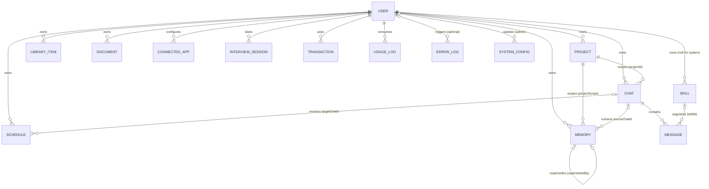

# 03 — Data Models & Database Architecture

NexAI persists application state in **MongoDB** using **Mongoose 8** (`server/src/models/`). There are **16 model files** defining **15 distinct MongoDB collections** (`Prompt.js` is an alias pointing directly to the `Skill` model so prompts and skills share the `skills` collection). Every schema includes `{ timestamps: true }` (`createdAt`, `updatedAt`).

---

## 1. Unified Entity-Relationship Diagram

---

## 2. Core Identity, Billing & Governance Collections

### 2.1 `User` (`server/src/models/User.js`)
Stores user authentication credentials, role permissions, prepaid credit wallet, and workspace preferences.
- **Fields:**
  - `email`: `String` (`required`, `unique`, `lowercase`, `trim`)
  - `passwordHash`: `String` (`select: false`, omitted by default and stripped in `toJSON`)
  - `googleId`: `String` (`unique`, `sparse: true`)
  - `role`: `'user' | 'admin'` (default `'user'`)
  - `wallet`: `{ creditsRemaining: Number (default 100, min 0), tier: 'free' | 'pro_monthly', totalTokensConsumed: Number (default 0) }`
  - `settings`:
    - `theme`: `'dark' | 'light'` (default `'dark'`)
    - `defaultModel`: `'flash' | 'pro'` (default `'flash'`)
    - `webSearchDefaultOn`: `Boolean` (default `false`)
    - `toolExecutionMode`: `'auto' | 'confirm' | 'manual'` (default `'auto'`)
    - `personalization`: `{ customInstructions: String (max 2000), responseTone: 'default' | 'concise' | 'detailed' | 'technical' | 'casual', aiMemoryEnabled: Boolean (default true) }`
- **Security Transform:** `toJSON` deletes `passwordHash` and `__v` on serialization.

### 2.2 `Transaction` (`server/src/models/Transaction.js`)
Immutable billing ledger for Razorpay orders and recharges.
- **Fields:** `userId` (`ObjectId` ref `User`, indexed), `amountINR` (`Number`), `creditsAdded` (`Number`), `paymentGateway` (default `'razorpay_test'`), `paymentId` (`String`, `unique: true`, `sparse: true`), `orderId` (`String`), `planId` (`String`), `status` (`'pending' | 'success' | 'failed'`).
- **Indexes:** `{ userId: 1, createdAt: -1 }`, `{ orderId: 1 }`, plus unique sparse index on `paymentId` guaranteeing **idempotent single-credit processing** even under race conditions between `/wallet/verify` and `/webhooks/razorpay`.

### 2.3 `UsageLog` (`server/src/models/UsageLog.js`)
Per-call metering ledger powering both Admin telemetry charts and Google Gemini daily RPD/RPM/TPM calculation.
- **Fields:** `userId` (`ObjectId` ref `User`), `model` (`'flash' | 'pro' | 'tts'`), `feature` (`'chat' | 'library' | 'docgen' | 'document' | 'interview' | 'schema'`), `tokensUsed` (`Number`), `creditsDeducted` (`Number`).
- **Indexes:** `{ userId: 1, createdAt: -1 }`.

### 2.4 `SystemConfig` (`server/src/models/SystemConfig.js`)
Singleton configuration document (`_id: 'global_config'`) controlling runtime quota governance.
- **Fields:** `_id` (`String`, default `'global_config'`), `billingEnforcementMode` (`'quota_free' | 'credit_strict'`, default `'quota_free'`), `dailyGeminiQuotaLimit` (`Number`, default `1500`, min `1`), `updatedBy` (`ObjectId` ref `User`).

### 2.5 `ErrorLog` (`server/src/models/ErrorLog.js`)
Stores unhandled HTTP `5xx` server errors captured by `errorHandler.js` for the Admin Dashboard.
- **Fields:** `route`, `method`, `status` (`Number`), `message`, `stack` (optional), `userId` (`ObjectId` optional).
- **Indexes:** `{ createdAt: -1 }`.

---

## 3. Conversational, Project & Memory Collections

### 3.1 `Project` (`server/src/models/Project.js`)
Isolated ChatGPT-style workspace holding system instructions and local source files.
- **Fields:** `userId` (`ObjectId` indexed), `name` (max 100), `description` (max 500), `customInstructions` (max 4000), `color` (default `'#8b5cf6'`), `icon` (default `'folder'`), and embedded `sources` subdocuments (`name`, `originalName`, `mimeType`, `size`, `content`, with own `timestamps: true`).
- **Indexes:** `{ userId: 1, createdAt: -1 }`.

### 3.2 `Chat` (`server/src/models/Chat.js`)
Conversation container optionally bound to a `Project` or marked ephemeral (`isTemporary`).
- **Fields:** `userId` (indexed), `projectId` (`ObjectId` ref `Project`, `default: null`, indexed), `title` (default `'New Chat'`), `pinned` (`Boolean`), `isTemporary` (`Boolean`, `default: false`, indexed).
- **Indexes:** `{ userId: 1, createdAt: -1 }`, `{ userId: 1, projectId: 1, updatedAt: -1 }`.

### 3.3 `Message` (`server/src/models/Message.js`)
Stores each user or assistant turn, thought traces, tool execution timelines, search grounding citations, extracted memory badges, and multimodal attachments.
- **Fields:**
  - `chatId` (`ObjectId` ref `Chat`, indexed), `role` (`'user' | 'assistant'`), `content` (`String`), `thoughts` (`String`), `tokensUsed` (`Number`), `skillId` (`ObjectId` ref `Skill`)
  - `steps`: `[{ id, type, tool, title, input, output, status ('running'|'completed'|'failed'), timestamp }]`
  - `groundingMetadata`: `{ webSearchQueries: [String], sources: [{ title, url }] }`
  - `memoriesUpdated`: `[{ id, fact, category, action }]`
  - `attachments`: `[{ name, mimeType (required), data (base64 or data URL), size }]`
- **Indexes:** `{ chatId: 1, createdAt: 1 }` for sequential chronological reads.

### 3.4 `Memory` (`server/src/models/Memory.js`)
Cross-chat semantic memory records with temporal versioning (`validFrom` / `validTo` / `supersededBy`), retrieval telemetry (`lastUsedAt`, `useCount`), and `global` vs `project` scoping.
- **Fields:**
  - `userId` (`ObjectId` indexed), `fact` (`String`, trimmed), `category` (`'identity' | 'preference' | 'project' | 'fact' | 'instruction'`), `confidence` (`0..1`, default `1.0`)
  - Provenance: `sourceChatId` (`ObjectId` ref `Chat`), `sourceMessage` (`String`)
  - Control: `pinned` (`Boolean`), `active` (`Boolean`, default `true`), `key` (`String`, semantic slot key such as `user.location`)
  - Scoping: `scope` (`'global' | 'project'`, default `'global'`), `projectId` (`ObjectId` ref `Project`, nullable)
  - Temporal Superseding: `supersededBy` (`ObjectId` ref `Memory`), `validFrom` (`Date`), `validTo` (`Date`)
  - Vector & Usage: `vectorId` (`String`), `embedding` (`[Number]`, local fallback backup), `lastUsedAt` (`Date`), `useCount` (`Number`, min `0`)
- **Indexes:** `{ userId: 1, active: 1, createdAt: -1 }`, `{ userId: 1, category: 1 }`, `{ userId: 1, scope: 1, projectId: 1, active: 1 }`.

---

## 4. Knowledge Library, Documents & Interview Collections

### 4.1 `LibraryItem` (`server/src/models/LibraryItem.js`)
Polymorphic unified knowledge vault storing all 5 asset types (`'link' | 'note' | 'document' | 'file' | 'interview'`).
- **Common Fields:** `userId` (indexed), `type` (indexed), `title`, `summary`, `tags` (`[String]`), `content`, `vectorId` (legacy single-vector pointer), `vectorIds` (`[String]`, multi-chunk vectors), `pinned` (`Boolean`, indexed).
- **Type-Specific Fields:**
  - `link`: `url`
  - `document`: `category` (`'resume' | 'report' | 'spec' | 'notes' | 'other'`), `sections: [{ heading, body }]`, `fileFormat` (default `'pdf'`)
  - `file`: `fileName`, `mimeType`, `size`, `fileData` (Data URL / base64 for downloads and image previews)
  - `interview`: `scorecard` (`Mixed`), `transcript` (`Array`), `topic`, `difficulty`, `role`
- **Indexes:** `{ userId: 1, createdAt: -1 }`, `{ userId: 1, type: 1, createdAt: -1 }`, plus 6-field **Full-Text `$text` index** across `title`, `summary`, `tags`, `content`, `sections.heading`, `sections.body`.

### 4.2 `Document` (`server/src/models/Document.js`)
Standalone structured document schema from early Steps (`userId`, `title`, `category: ['resume', 'report', 'notes', 'other']`, `sections: [{ heading, body }]`, `fileFormat: 'pdf'`, `$text` index on `title` + `sections.body`).
- **Implementation Note:** In the consolidated architecture (Step 8), user-facing documents live in `LibraryItem` (`type: 'document'`). However, two server services still reference `Document`: `tools.service.js` (`workspace_search` queries `Document` alongside `Project` and `LibraryItem`) and `schedule.service.js` (`executeSchedule` writes `Document.create({ ..., type: 'document', content })` when `deliveryTarget === 'library'`, even though `Document` defines `sections` rather than `content`).

### 4.3 `InterviewSession` (`server/src/models/InterviewSession.js`)
Tracks interactive mock technical and MSBTE viva interview sessions.
- **Fields:** `userId` (indexed), `role`, `difficulty` (`'junior' | 'mid' | 'senior'`), `topic`, `status` (`'in_progress' | 'completed' | 'incomplete'`, indexed), `messages: [{ role ('assistant'|'user'), content, tokensUsed, timestamp }]`, `scorecard` (`overallScore 0..100`, `rating: 'Strong Hire' | 'Hire' | 'Needs Improvement' | 'Unprepared' | 'Incomplete'`, `categories: { technicalAccuracy, problemSolving, communication, systemDesign }`, `strengths`, `improvements`, `summary`, `recommendedTopics`), `totalTokensUsed`, `isSimulation` (`Boolean`).
- **Indexes:** `{ userId: 1, createdAt: -1 }`, `{ userId: 1, status: 1, createdAt: -1 }`.

---

## 5. Skills, Prompts & Automations Collections

### 5.1 `Skill` & `Prompt` (`server/src/models/Skill.js`, `server/src/models/Prompt.js`)
`Prompt.js` re-exports `Skill` (`export const Prompt = Skill`), unifying Prompt Vault templates and AI Agent Skills in the single `skills` MongoDB collection.
- **Fields:** `userId` (`ObjectId`, `default: null` for system built-in skills), `title`, `slug` (lowercase auto-slugified), `description`, `icon` (default `'Zap'`), `instructions` (required), `template` (synced with `instructions`), `variables` (`[String]`), `tools` (enum `['web_search', 'fetch_url', 'code_execution', 'workspace_search', 'memory_search']`), `category` (enum `['Research', 'Coding', 'Writing', 'Analysis', 'Productivity', 'General']`), `isSystem` (`Boolean`), `isFavorite` (`Boolean`), `tags` (`[String]`).
- **Mongoose Middleware Hooks:**
  - `pre('validate')`: mirrors `instructions <-> template` if only one is supplied.
  - `pre('save')`: extracts deduplicated `{{variable}}` tokens via `extractVariables(text)` (`/\s*\{\{\s*([a-zA-Z0-9_]+)\s*\}\}/` pattern `/\{\{\s*([a-zA-Z0-9_]+)\s*\}\}/g`), mirrors changes between `template` and `instructions`, and generates a hyphenated `slug` from `title`.
- **Indexes:** `{ userId: 1, isFavorite: -1, createdAt: -1 }`, `$text` index across `title`, `instructions`, `template`, `tags`, `description`.
- **Implementation Nuance:** `skill.service.js` `SYSTEM_SKILLS` defines `'database-erd-architect'` with `category: 'Architecture'` and `tools: ['schema_modeling']`, neither of which is in `Skill.js`'s `enum` arrays—when `ensureSystemSkills()` saves via Mongoose, Mongoose validation catches and warns/skips that specific seed item (`"Failed to upsert system skill Database & ERD Architect"`), while the other 4 system skills seed cleanly.

### 5.2 `Schedule` (`server/src/models/Schedule.js`)
Background recurring or one-shot automation tasks evaluated every 60 seconds.
- **Fields:** `userId` (indexed), `title` (max 120), `description` (max 300), `instructions` (max 4000), `frequency` (`'daily' | 'weekly' | 'once'`), `weeklyDays` (`[0..6]`, default Mon–Fri `[1,2,3,4,5]`), `runTime` (`HH:mm` regex), `isActive` (`Boolean`, indexed), `model` (`'flash' | 'pro'`), `deliveryTarget` (`'chat' | 'library'`), `targetChatId` (`ObjectId` ref `Chat`), `lastRunAt` (`Date`), `lastRunStatus` (`'idle' | 'running' | 'success' | 'failed'`), `lastRunSummary` (`String`), `totalRuns` (`Number`).
- **Indexes:** `{ userId: 1, isActive: 1 }`.

### 5.3 `ConnectedApp` (`server/src/models/ConnectedApp.js`)
Stores user-level integration configurations for ecosystem connectors (`'github' | 'google-drive' | 'web-search' | 'notion' | 'figma'`).
- **Fields:** `userId` (indexed), `appSlug` (enum above), `name`, `description`, `icon`, `category`, `isConnected` (`Boolean`), `credentials: { apiKey (select: false), webhookUrl, accountName }`, `scopes` (`[String]`), `settings` (`Mixed`), `lastSyncedAt` (`Date`).
- **Indexes:** Compound unique index `{ userId: 1, appSlug: 1 }`.
