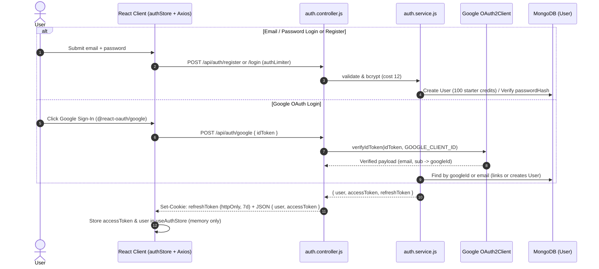
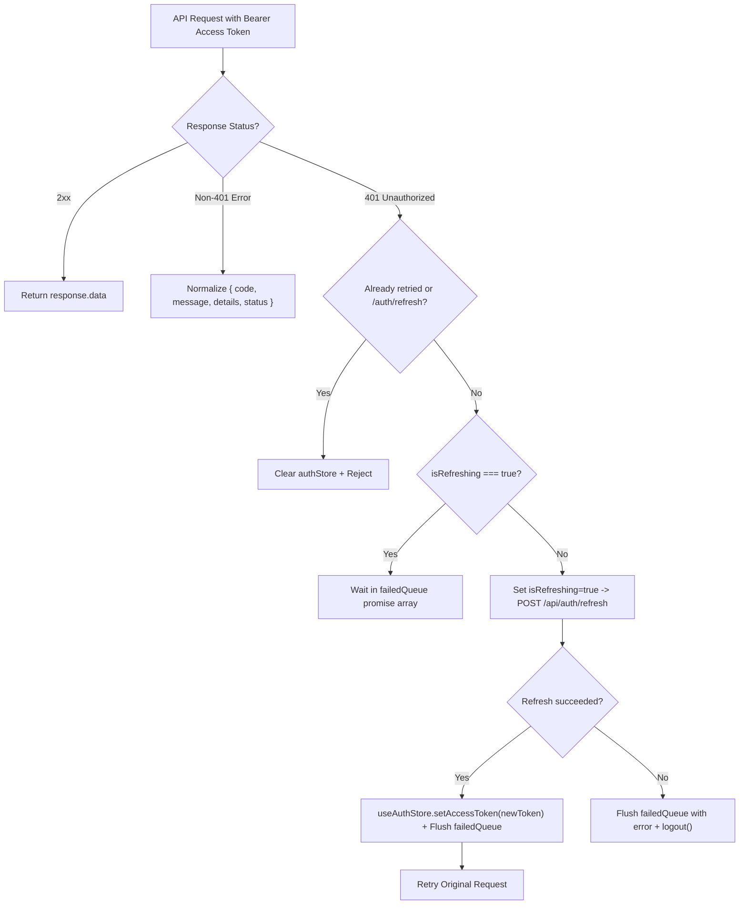

# 04 — Authentication, Authorization & Security Architecture

NexAI protects user data and AI quotas through a defense-in-depth pipeline spanning **dual-token JWT sessions**, **Google OAuth verification**, **automatic client 401 refresh queues**, **RBAC guards**, **Zod validation**, **multi-tenant `userId` filtering**, and **cryptographic webhook verification**.

---

## 1. Dual-Token Authentication Flow

Instead of storing long-lived JWTs in `localStorage` (which exposes tokens to XSS) or making every API request rely strictly on cookies (which complicates Bearer auth in `fetch` SSE streams), NexAI splits credentials by sensitivity and lifetime:

1. **Access Token (`15m` expiry):** Signed with `env.JWT_ACCESS_SECRET` containing `{ userId, role }`. Stored **strictly in React memory** (`useAuthStore.accessToken`) and attached as `Authorization: Bearer <token>`.
2. **Refresh Token (`7d` expiry):** Signed with `env.JWT_REFRESH_SECRET` containing `{ userId, role }`. Stored inside an **`httpOnly` cookie** (`refreshToken`) inaccessible to browser JavaScript. In `production`, cookies set `secure: true, sameSite: 'none'` (required because the Vercel frontend and Render backend run on separate domains); in local development, `sameSite: 'lax', secure: false`.

### App Mount Hydration & Transparent 401 Refresh Queue (`client/src/lib/api/client.js`)
Because the access token lives only in memory, refreshing the browser clears `useAuthStore.accessToken`:
1. On initial mount in `App.jsx`, `useAuthStore.getState().checkAuth()` executes `POST /api/auth/refresh` (with `withCredentials: true`). If a valid `refreshToken` cookie exists, the backend mints a fresh 15-minute access token and returns `{ user, accessToken }`.
2. During active usage, if any Axios request fails with `401` (`!originalRequest._retry`):
   - Concurrent `401` requests push onto `failedQueue` while `isRefreshing = true`.
   - A single `POST /api/auth/refresh` call acquires a fresh `accessToken`.
   - All queued requests are resolved and transparently replayed with the new `Authorization: Bearer` header.
   - If refresh itself fails (and not on `/api/auth/refresh` or `/api/auth/login` or `/api/auth/register`), the store calls `logout()` cleanly.

---

## 2. Password & OAuth Security Details (`server/src/services/auth.service.js`)
- **Bcrypt Cost Factor 12:** `bcrypt.hash(password, 12)` (`SALT_ROUNDS = 12`).
- **Google OAuth Linking:** If a user previously signed up with email/password and later logs in via Google using the same verified email, `googleLogin()` attaches `user.googleId = payload.sub` and persists it.
- **Public Token Hygiene:** Refresh tokens are rotated only in cookies (`res.cookie('refreshToken', ...)`), never returned in response JSON payloads (`server/src/controllers/auth.controller.js`).

---

## 3. Authorization, Route Guards & RBAC

| Layer | Implementation | Behavior |
| :--- | :--- | :--- |
| **Backend Auth Middleware** | `server/src/middleware/auth.js` | Parses `Authorization: Bearer <token>`, verifies JWT signature (`verifyAccessToken`), checks `User.findById(decoded.userId)` (rejecting `401 ACCOUNT_NOT_FOUND` if deleted), and attaches `req.user`. |
| **Backend Role Gate** | `server/src/middleware/requireRole.js` | `requireRole(...roles)` checks `req.user.role`; throws `403 FORBIDDEN` if unauthorized. Applied to all `/api/admin/*` routes. |
| **Frontend Session Guard** | `client/src/router/ProtectedRoute.jsx` | Displays centered loading screen with `<NexAiLogo glow />` + `<Spinner />` while `!isInitialized`; redirects unauthenticated users to `/login` preserving `location.state.from`. |
| **Frontend Admin Guard** | `client/src/router/AdminRoute.jsx` | Checks `isAuthenticated` then verifies `user?.role === 'admin'`; renders an explicit **403 Access Restricted** card with "Return to Chat" action for standard users. |

---

## 4. Input Validation, Rate Limiting & Hardening

### 4.1 Multi-Source Zod Validation (`server/src/middleware/validate.js`)
Every mutating or parameterized route passes `{ body, query, params }` Zod schemas to `validate(...)`:
- Returns HTTP `400 VALIDATION_ERROR` with field-level `details` (`err.errors.map(e => ({ path, message }))`).
- Note on Express 5 compatibility: `validate.js` avoids mutating read-only `req.query` directly where restricted (`Object.assign` fallback), writing sanitized `parsedQuery` cleanly.

### 4.2 Express Rate Limiters
| Limiter | Window & Cap | Target Routes | Bypass Condition |
| :--- | :--- | :--- | :--- |
| `authLimiter` (`auth.routes.js`) | 15 minutes / **30 requests per IP** | `POST /auth/register`, `/login`, `/google` | `NODE_ENV === 'test'` |
| `aiLimiter` (`chat`, `library`, `interview`, `schema`) | 1 minute / **30 requests per IP** | AI generation & TTS endpoints | `NODE_ENV === 'test'`, plus `isSimulation === true` / `x-simulation === 'true'` in `interview` & `schema` routes |

### 4.3 Security Controls Matrix
- **Multi-Tenant Isolation:** Every database query (`Chat`, `Message`, `Project`, `LibraryItem`, `Memory`, `Schedule`, `ConnectedApp`, `InterviewSession`, `Transaction`) filters strictly by `{ userId: req.user._id }`, and Pinecone/memory vector searches always pass `{ userId }` filters. Cross-user access returns `404` or `403` cleanly.
- **Prompt Injection Defense:** System prompts (`server/src/agents/prompts/*.js`) are passed via Gemini's structured `systemInstruction` config parameter rather than concatenated into user chat messages, isolating privileged directives. Structured outputs (`tagging`, `docGen`, `interview conclude`, `memory extract/reconcile`, `schema`) enforce `responseMimeType: 'application/json'` and validate against Zod schemas (`docGen.agent.js`, `interview.agent.js`).
- **Sensitive Credential Filtering in Memory (`memory.service.js`):** Before saving extracted facts, `SENSITIVE_CREDENTIAL_REGEX` blocks accidental storage of passwords, API keys, secrets, tokens, CVVs, or card numbers unless explicitly preceded by an intentional `"remember"` command.
- **Webhook & Payment Tamper-Proofing (`razorpay.service.js`):** Pricing is read solely from server `PLANS` (`config/plans.js`); Razorpay checkout signatures verify `HMAC-SHA256(orderId|paymentId, RAZORPAY_KEY_SECRET)`; webhooks verify `X-Razorpay-Signature` against the unparsed raw request `Buffer` using `RAZORPAY_WEBHOOK_SECRET`.
- **Encrypted/Hidden Integration Secrets:** `ConnectedApp.credentials.apiKey` is marked `select: false` so API keys are never returned to the frontend when listing connected apps (`connectedApp.controller.js`).
