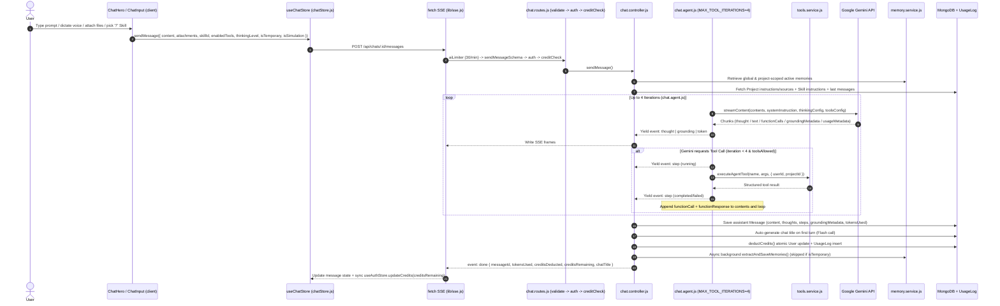
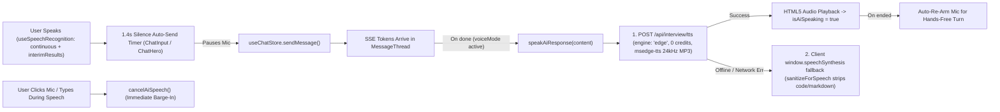

# 05 — Chat Canvas, SSE Streaming, Agentic Tools & Voice Mode

The Conversational AI workspace (`/`, `/chat`, `/chat/:chatId`) is NexAI's primary interaction surface. It pairs a distraction-free hero & message canvas with real-time **Server-Sent Events (SSE)** streaming, an autonomous multi-iteration tool loop, rich client-side diagram/code rendering, and a hands-free neural voice conversation mode.

---

## 1. End-to-End Chat Streaming & Tool Execution Flow



---

## 2. Frontend Chat Architecture & UX Features

### 2.1 Context-Aware Hero State (`ChatHero.jsx` & `greetingHelper.js`)
When starting a fresh conversation without messages (`!activeChatId && messages.length === 0`), `ChatHero` displays a time-of-day personalized welcome using `getGreetingContext(user)`:
- **00:00–04:59:** *"Burning the midnight oil, `<FirstName>`?"* (`Late Night`)
- **05:00–11:59:** *"Good morning, `<FirstName>`!"* (`Morning`)
- **12:00–16:59:** *"Good afternoon, `<FirstName>`!"* (`Afternoon`)
- **17:00–20:59:** *"Good evening, `<FirstName>`!"* (`Evening`)
- **21:00–23:59:** *"Working late, `<FirstName>`?"* (`Night`)
- `getFirstName(user)` extracts and capitalizes the first token from `user.name` or the prefix of `user.email`.

### 2.2 Composer & Multi-Context Attachment Pipeline (`ChatInput.jsx`)
- **Elastic Auto-Growth Textarea:** Automatically scales height cleanly on multi-line input (`Enter` submits; `Shift+Enter` inserts newline).
- **Additive Multi-Attachments (`+` Popover & Drag-and-Drop):** `AttachContextPopover` lets users:
  1. **Upload from Device** (supports multi-file queuing for images, PDFs, Markdown, CSV, JSON, code files — converted to Data URLs/base64 or text payloads).
  2. **Attach from Library** (searches `LibraryItem` entries directly inside the popover).
  3. **Select Agent Skills** (opens the inline/attached skill picker).
  4. **Attach Preview (`AttachedContextPreview.jsx`):** Renders images as compact `58×58px` clickable thumbnails and documents/notes/code as slim single-line chips, opening a body-portaled **`AttachmentLightbox.jsx`** (`createPortal(..., document.body)`) on click.
- **Slash & Mention Skill Autocomplete (`SlashSkillsPopover.jsx` & `SkillPickerModal.jsx`):** Typing `/` or `@` pops open a keyboard-navigable (`↑`/`↓`/`Enter`/`Esc`) autocomplete menu above the composer; selecting a skill sets `activeSkill` in `useSkillStore` and prompts for variables via `VariableFillModal` when needed.
- **Standalone Mode Toggles & Tool Pills:** Quick pills/toggles for Web Search (`web_search`), Demo Simulation Mode (`isSimulation`), and Temporary/Ephemeral Chat (`isTemporary` in `Topbar.jsx`).

### 2.3 Model Selector & Thinking Depth (`chatStore.js`, `ModelSelectorPopover`, `ModelSelectorModal`)
- `AVAILABLE_MODELS` lists Flash & Pro plus preview catalog badges (`fable-5-1`, `opus-5-5`, `sonnet-5-5`, `haiku-5-5`, `deepseek-r1`, `gpt-4o`, `pro`, `flash`). Internally each maps to `backendModel: 'flash' | 'pro'` routed through NexAI's Gemini backend.
- **Thinking Configuration (`chat.agent.js` `buildThinkingConfig`):**
  - Frontend `ModelSelectorModal` exposes `off | low | medium | high` matching `chat.validator.js` (`EFFORT_LEVELS` in `chatStore.js` also exposes `extra`/`max` constants mapped in UI controls).
  - For Gemini 3 models (`modelName.includes('3')`), passes `{ includeThoughts: true, thinkingLevel: level }`. For Gemini 2.5 models, passes `thinkingBudget`: `low -> 1024`, `medium -> 4096`, `high -> 8192`.

### 2.4 Rich Message Rendering & Ergonomics (`MessageThread.jsx` & Child Renderers)
- **Render Performance Optimization (`BUG-002` fix):** Each turn is wrapped in a memoized `MessageItem` with stabilized callbacks and `requestAnimationFrame`-throttled auto-scroll + a floating scroll-to-bottom anchor so live SSE token streaming never remounts Prism or Mermaid blocks.
- **Markdown & Normalization (`MarkdownRenderer.jsx`):** Uses `react-markdown` + `remark-gfm` + `tableNormalizer.js` (normalizes inline `||` pipe-joined Markdown tables outside fenced code blocks).
- **Custom Fenced Code Renderers:**
  - **`CodeBlock.jsx`:** Sticky header bar with language badge, `Prism.highlight`, 1-click Copy, and **Save Snippet** (opens global `SaveItemModal` prefilled with `SnippetEditor`).
  - **`FileTreeBlock.jsx`:** Triggered on tree-formatted directory code blocks (`tree` / `filetree`), rendering semantic folder/code/doc file icons and comment badges.
  - **`MermaidBlock.jsx` + `DiagramLightbox.jsx`:** Validates syntax with `mermaid.parse` (250ms debounce while streaming so incomplete tokens don't flash errors), dynamically adapts theme colors (`isDark`), toggles `Diagram | Code`, exports `.svg`, saves diagram notes to Library, and opens a full pan/zoom lightbox (`0.5x–2.5x`).
  - **`PromptBlock.jsx`:** Special renderer for ````prompt ... ```` fenced blocks providing "Save to Prompt Vault" and "Use in Chat" triggers.
- **Reasoning & Execution Transparency:**
  - **`InlineThinking.jsx`:** Auto-expands while `isThinking === true`, auto-collapses when generation starts, and formats reasoning Markdown with copy support.
  - **`AgentStepTimeline.jsx`:** Displays step-by-step live tool execution badges (`running` / `completed` / `failed`) and clickable web `groundingMetadata` source pills.
  - **`ThinkingDrawer.jsx`:** Slide-over right-hand Telemetry Inspector inspecting model tier, thinking depth, prompt/candidate/total token counts, credits deducted, latency, and reasoning trace.
- **In-Place Regeneration & Message Actions:** Users can copy, rate feedback, **Read Aloud** (neural TTS), **Save to Library**, **Save to Prompt Vault**, or **Regenerate** (`regenerateResponse` resets and streams the assistant slot in place without duplicating the user turn).
- **Temporary (Ephemeral) Chats:** Toggled from `Topbar.jsx`, flagged with `isTemporary: true`, styled with dashed borders/`Ephemeral` badge, skipped from long-term memory extraction (`memory.service.js`), and cleared cleanly when leaving.

---

## 3. Autonomous Tool Execution & Search Engine (`tools.service.js`)

When `enabledTools` or a `Skill` is active on a chat message, `chat.agent.js` invokes `buildGeminiToolsConfig(enabledTools)`:

| Tool Name | Mode | Implementation in `tools.service.js` |
| :--- | :--- | :--- |
| **`web_search`** | Native `googleSearch` (if enabled without function tools) OR Function Calling declaration | **Quota-Free 3-Tier Waterfall:** 1) DuckDuckGo HTML (`html.duckduckgo.com`) parsed via Cheerio -> 2) Wikipedia OpenSearch API fallback -> 3) Bing Web Search (`bing.com/search`) parsed via Cheerio. Every scrape is checked by `isResultRelevant()` to reject bot-deflection/CAPTCHA pages and verify keyword overlap. |
| **`fetch_url`** | Function Declaration | Validates URL protocol via `linkExtractor.isValidUrl()`, extracts page title & clean body text (trimmed for context budget) using `linkExtractor.extractLinkContent()`. |
| **`workspace_search`** | Function Declaration | Searches across three tenant-scoped stores: `Project.sources`, `LibraryItem` (Regex/Text), and `Document` (`'sections.content'` query — note `Document.js` schema defines `sections.body`). Returns up to top matches across all sources. |
| **`memory_search`** | Function Declaration | Calls `memoryService.getRelevantMemories(userId, query, { projectId, limit: 8 })` so the agent can pull user facts on demand mid-reasoning. |
| **`code_execution`** | Function Declaration | Safe dry-run sandbox stub (`code_execution` outputs guidance/warning rather than executing arbitrary OS processes on the backend host). |

### Failover & Loop Safeguards (`chat.agent.js` & `gemini.service.js`)
- **Iteration Guard:** Caps at `MAX_TOOL_ITERATIONS = 4`. On iteration 4 (or when no tools are allowed), explicitly forces `toolConfig: { functionCallingConfig: { mode: 'NONE' } }` so Gemini synthesizes a final user answer instead of requesting another tool call.
- **Empty Synthesis Rescue:** If the loop ends with tool observations collected (`collectedToolResults.length > 0`) but zero assistant text was streamed, `chat.agent.js` makes a direct `generateContent` synthesis call using collected tool outputs.
- **429 Model Failover (`gemini.service.js`):** If streaming or generation throws `429` / `RESOURCE_EXHAUSTED`, `gemini.service.js` automatically fails over to `'gemini-3.1-flash-lite'` and retries once without native `googleSearch`.
- **Stream Chunk Resilience (`gemini.service.js`):** Ignores trailing SDK `'Incomplete JSON segment'` parse errors after content chunks have already streamed so partial/complete replies never abort unnecessarily.
- **Offline Simulation (`utils/chatSimulator.js`):** When `isSimulation === true`, `streamChatSimulation()` generates rich deterministic sample code/architecture replies with zero Gemini calls and `0` credit cost.

---

## 4. Hands-Free Voice Conversation Mode & Dual TTS Engine



- **Web Audio Cues (`client/src/lib/utils/audioFeedback.js`):** Generates subtle synthetic oscillator tones via browser `AudioContext` (`playMicStartSound()`, `playMicStopSound()`, `playSuccessTone()`) without external MP3 assets.
- **Speech Sanitizer (`client/src/lib/utils/speechSynthesis.js`):** `sanitizeForSpeech()` strips fenced code blocks (`"code block omitted"` / removal), inline backticks, Markdown headers, bold/italic markers, links (preserving anchor text), and bullet prefixes before sending text to speech engines.
