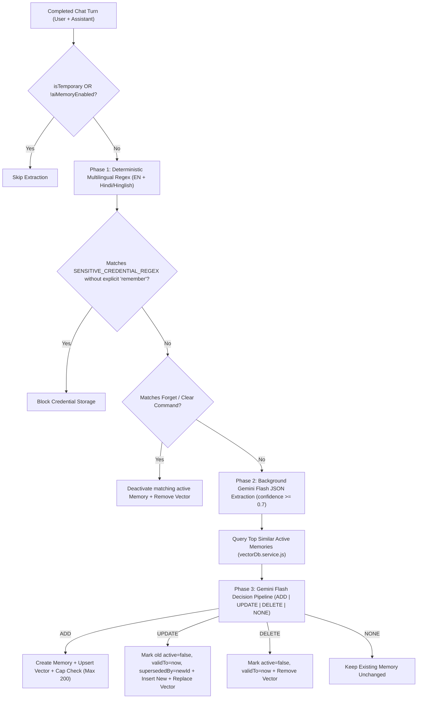
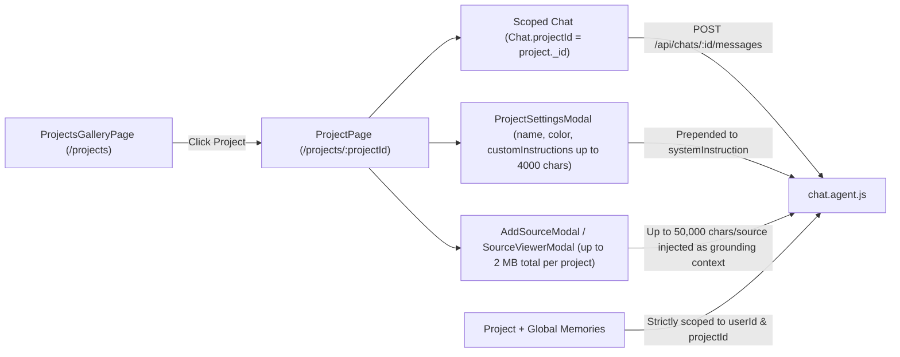

# 06 — Long-Term Memory, Personalization & Project Workspaces

NexAI separates context into **Short-Term Memory** (the active chat window), **Persistent Cross-Chat Memory** (`Memory` collection + vectors), and **Project Workspaces** (`Project` collection with custom instructions and local knowledge files).

---

## 1. Cross-Chat Long-Term Memory Architecture (`server/src/services/memory.service.js`)

Traditional chat apps forget your stack, role, constraints, and instructions as soon as you click **New Chat**. NexAI implements an autonomous **extract → reconcile → supersede → retrieve** lifecycle spanning `Memory.js`, `memory.service.js`, `memory.prompt.js`, and `MemoryManager.jsx`.

### 1.1 Extraction: Multilingual Regex + Async Gemini Flash
`memory.service.js` combines zero-latency deterministic rules with nuanced LLM extraction:
- **Explicit Directives & Identity Patterns (English + Hindi/Hinglish):**
  - Captures explicit commands like `"Remember that ..."`, `"Always ..."`, `"Never ..."`, `"My name is ..."`, `"I live in ..."`, `"I work as ..."`, `"I use ..."`.
  - Also parses Hindi/Hinglish patterns including `"mera naam ... hai"`, `"yaad rakhna ..."`, `"main ... mein rehta hoon"`, `"bhool jao ..."` (forget commands).
- **LLM Candidate Extraction:** After the SSE stream completes (`done`), background extraction runs via `memory.prompt.js` (`MEMORY_EXTRACTION_PROMPT`), keeping only candidates with `confidence >= 0.7`.
- **Two-Layer Scoping (`global` vs `project`):**
  - `scope: 'global'`: Candidate memories injected across all non-project chats and eligible inside project chats.
  - `scope: 'project'` + `projectId`: Strictly isolated to chats inside that `Project`, preventing project-specific assumptions (e.g., Java Spring Boot rules) from leaking into unrelated conversations.

### 1.2 Temporal Superseding & Reconciliation
When updating a conflicting fact (e.g., user says *"I moved to Bengaluru"* when an active memory says *"User lives in Pune"*):
1. Similarity search retrieves top active candidates sharing context or semantic slot `key` (such as `user.location`).
2. Gemini evaluates candidate vs existing facts (`MEMORY_RECONCILIATION_PROMPT`) and emits `{ action: 'ADD' | 'UPDATE' | 'DELETE' | 'NONE', targetMemoryId?, key?, fact? }`.
3. On `UPDATE`, the old `Memory` document is **never destroyed silently**—it is preserved for auditability with `active = false`, `validTo = new Date()`, and `supersededBy = newMemory._id`, while its stale vector embedding is deleted from Pinecone / memory store.

### 1.3 Weighted Retrieval & Safety Thresholds
When assembling context for a new chat turn (`getRelevantMemories`), `memory.service.js` executes:
1. Priority fetch of `category: 'identity'` and `pinned: true` active memories (respecting `scope`/`projectId`).
2. Query embedding via `geminiService.embedContent(query)` -> `vectorDbService.query` (`userId` + active filter).
3. Multi-factor scoring across similarity matches:
   $$\text{score} = (\text{similarity} \times 0.6) + (\text{recencyScore} \times 0.2) + (\text{confidence} \times 0.1) + \text{pinnedBoost}$$
   - Applies strict similarity thresholding so low-relevance noise is rejected (eliminating unfiltered random recency backfill), with a lexical regex fallback if vector search fails or is unavailable.
   - Tracks usage telemetry by updating `lastUsedAt` and incrementing `useCount` on retrieved records.
   - Injects retrieved entries into `chat.agent.js` under `[USER LONG-TERM MEMORY (CROSS-CHAT PERSISTENT CONTEXT)]`.

### 1.4 200-Memory Cap, Pruning & AI Consolidation
- **Capacity Enforcement:** Each user is capped at **200 active memories**. Adding beyond 200 triggers `pruneOldMemories()`, removing oldest unpinned, low-`useCount` items.
- **Startup Vector Repair (`syncActiveMemoryVectors`):** Called on server boot in `server.js` to embed and index any active memories missing vectors.
- **Manual Control & Consolidation (`MemoryManager.jsx`):** Users manage memories in `SettingsPage.jsx` or the two-column `SettingsModal.jsx` (`AI Memory & Tuning` tab):
  - Toggle `aiMemoryEnabled` (`PATCH /api/users/me/settings`), edit response tone (`default | concise | detailed | technical | casual`), and set global `customInstructions` (up to 2,000 chars).
  - Manually create, inline-edit, pin/unpin, search/filter by category (`identity`, `preference`, `project`, `fact`, `instruction`), delete one, **Consolidate with AI** (`POST /api/memories/consolidate` merges redundant facts), or **Clear All** (`DELETE /api/memories`).

---

## 2. Project Workspaces (`/projects`, `/projects/:projectId`)

Projects act as isolated collaborative workspaces (matching ChatGPT Projects) bundling custom instructions, local reference files, scoped chats, and scoped memories.

### Key Implementation Details (`Project.js`, `projectStore.js`, `ProjectPage.jsx`, `chat.agent.js`)
- **Capacity Budgeting:** Each project supports multiple uploaded files (`Markdown`, `PDF`, `TXT`, `JSON`, `SQL`, code files `.js/.ts/.py/.css/etc.`) inside `Project.sources`, tracked client-side with a **2 MB capacity meter** (`AddSourceModal.jsx`, `ProjectPage.jsx`).
- **Context Injection (`chat.agent.js`):** When chatting inside a project, `streamChatReply` injects `project.customInstructions` plus each source's content (sliced up to **50,000 characters per source**) directly into Gemini's `systemInstruction`.
- **Safe Unlinking (`project.controller.js`):** Deleting a project unlinks associated conversations (`Chat.projectId = null`) instead of wiping chat history. Users can also move existing conversations into or out of projects via `MoveToProjectModal.jsx`.
