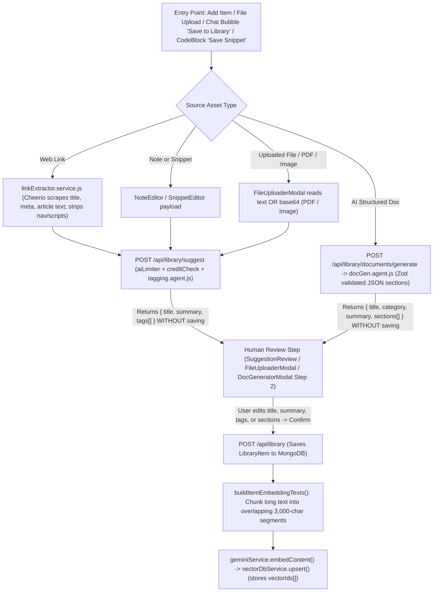

# 07 — Consolidated Knowledge Library, Vector RAG & PDF Engine

The **Consolidated Library** (`/library`, `/documents`, `/documents/:id`) unifies web bookmarks, markdown notes, code snippets, uploaded local files, AI-generated documents, and mock interview scorecards into a single searchable semantic repository.

---

## 1. Human-in-the-Loop Ingestion ("Suggest → Review → Confirm")

NexAI deliberately prevents LLMs from writing summaries, tags, or generated documents directly into your database without inspection:

---

## 2. Polymorphic Asset Types (`LibraryItem.js` & `LibraryPage.jsx`)

`LibraryPage.jsx` displays counts and instant tab filters across five asset categories stored in `LibraryItem`:

| Tab / Type | Model `type` Value | Ingestion & Special Viewer / Modal |
| :--- | :--- | :--- |
| **Notes & Links** | `'note'` \| `'link'` | `SaveItemForm` (`NoteEditor` with bold/italic/heading/code/list/task shortcuts `Ctrl+B/I/K` + live Markdown preview; `SnippetEditor` with Prism highlighting); URL metadata scraped via Cheerio (`linkExtractor.service.js`). |
| **Documents** | `'document'` | Drafted in `DocGeneratorModal` (5 categories: `resume`, `spec`, `report`, `notes`, `other`) with split-pane live editor + PDF sheet preview; viewed/edited in `ItemDetailModal` or `DocumentViewModal`; exported via `pdf-lib`. |
| **Files** | `'file'` | Drag-and-drop in `FileUploaderModal` supporting 30+ text/code extensions (`.js`, `.ts`, `.py`, `.sql`, `.yaml`, `.rs`, `.go`, etc.), images (thumbnail preview + base64 storage), and PDFs (multimodal Gemini Flash PDF comprehension). |
| **Interviews** | `'interview'` | Auto-archived on `POST /api/interview/:id/conclude`; renders 0–100 score dial, competency progress bars, strengths/improvements, recommended topics, and collapsible turn transcript inside `ItemDetailModal` / `InterviewViewModal`. |

### Bidirectional Chat ↔ Library Loops
- **Chat → Library:** Clicking **Save to Library** on any chat message or **Save Snippet** on any `CodeBlock` opens the globally mounted `SaveItemModal` (`AppLayout.jsx`) pre-filled via `useLibraryStore.openAddModal(prefill)`.
- **Library → Chat:** Clicking **Use in Chat** inside `LibraryCard` or `ItemDetailModal` navigates to `/chat` with formatted context prefilled, OR clicking **+** inside `ChatInput` attaches Library items directly into the next prompt turn.

---

## 3. Multi-Chunk Semantic Vector Indexing & Hybrid Retrieval

Early versions truncated text embeddings at 1,500 characters, hiding deeper sections of long specs and transcripts from semantic search (`ADR-024`).

### 3.1 Overlapping 3,000-Character Chunking (`library.controller.js`)
When creating or updating a `LibraryItem` (or archiving an interview):
1. `buildItemEmbeddingTexts(item)` builds composite text (`title`, `summary`, `tags`, `content`, flattened `sections`, or interview `scorecard` + `transcript`).
2. Long texts are segmented into overlapping **3,000-character chunks** with metadata `{ userId, type: item.type, refId: item._id, chunkIndex }`.
3. Each chunk vector ID is stored on `LibraryItem.vectorIds` (`[String]`). When updating or deleting an item, `vectorDbService.removeMany(item.vectorIds)` deletes stale embeddings to keep semantic results accurate.

### 3.2 Provider-Agnostic `vectorDb.service.js`
Designed behind a clean interface (`upsert`, `query`, `remove`, `removeMany`, `queryWithScores`) so infrastructure never leaks into controllers:
- **Production (`PINECONE_API_KEY` configured):** Initializes `@pinecone-database/pinecone` index (`env.PINECONE_INDEX`) and namespaces/filters strictly with `{ userId: String(userId) }`.
- **Resilient Local / Test Fallback:** Automatically stores vectors in an in-memory `Map` and computes exact **cosine similarity** when Pinecone credentials are missing or unreachable.
- **Hybrid Search (`GET /api/library/search?q=`):** Generates a query embedding with Gemini (`gemini-embedding-001`), queries matching `refId`s from the vector DB, merges with MongoDB `$text` search (across `title`, `summary`, `tags`, `content`, `sections.heading`, `sections.body`) and regex fallback, deduplicates by `_id`, and returns relevance-ranked results.

---

## 4. AI Document Generator (`docGen.agent.js`) & Pure-JS PDF Export (`pdfExport.service.js`)

### 4.1 Structured Document Drafting (`POST /api/library/documents/generate`)
1. Protected by `aiLimiter` (30 req/min) + `creditCheck`.
2. Calls `docGen.agent.js` with `DOC_GEN_SYSTEM_PROMPT` (`temperature: 0.4`, `responseMimeType: 'application/json'`) to produce `{ title, category, summary, sections: [{ heading, body }] }`.
3. Cleans accidental markdown code fences, validates output against Zod (`docOutputSchema`), deducts atomic credits (`ceil(tokens / 100)`), and logs `UsageLog { feature: 'docgen' }`.
4. Returns the draft for user editing in `DocGeneratorModal` without saving to MongoDB until the user clicks **Save to Library** or **Save & Download PDF**.

### 4.2 Server-Side PDF Rendering (`pdfExport.service.js`)
Because Render's free tier (512 MB RAM) struggles with headless Chromium (`puppeteer`), `GET /api/library/documents/:id/export.pdf` compiles PDFs in pure JavaScript using **`pdf-lib`**:
- Creates A4 pages (`595.28 × 841.89` pt) with embedded `StandardFonts.Helvetica` and `StandardFonts.HelveticaBold`.
- Implements custom word-wrapping measured against `font.widthOfTextAtSize()`, markdown bullet/heading sanitization (`sanitizePdfText()`), styled emerald/violet title header blocks, executive summary callout, automatic page breaks when `y < MARGIN_BOTTOM`, and `Page X of N` footers across every page.
- Streams bytes back with `Content-Type: application/pdf` and sanitized `Content-Disposition: attachment; filename="....pdf"`.
- **Implementation Nuance (`client/src/lib/api/library.api.js` L58–61):** `client.js`'s response interceptor already returns `response.data` for all responses, and `exportDocumentPdf` then wraps `new Blob([response.data], { type: 'application/pdf' })` before returning to `libraryStore.exportPdf` (`new Blob([blob])`). Checking blob payload handling when modifying PDF downloads is recommended.
