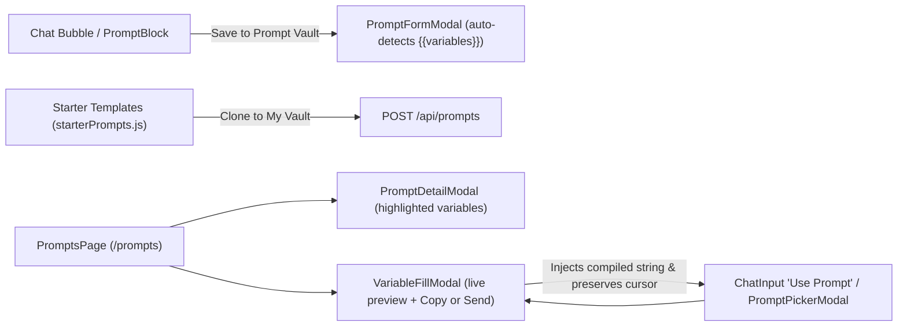
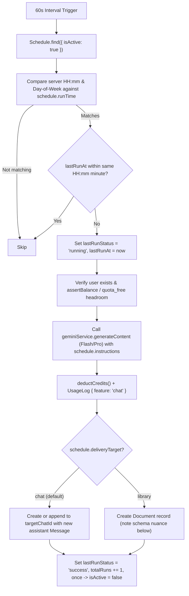

# 08 — Skills, Prompt Vault, Background Automations & Connected Apps

NexAI combines **reusable prompt engineering**, **tool-augmented Agent Skills**, **cron-style scheduled automations**, and **external app integrations**. Note that backend persistence and agent integration are fully active across all four subsystems, while two dedicated frontend management pages (`/skills` and `/automations`) have a specific router-mounting caveat documented in Section 5.

---

## 1. Shared Storage Model & `{{variable}}` Extraction (`Skill.js` / `Prompt.js`)

In the backend, `server/src/models/Prompt.js` is an alias (`export const Prompt = Skill`) pointing directly to the `Skill` model (`skills` MongoDB collection):
- **Unified Schema:** Holds `title`, `slug`, `description`, `icon`, `instructions`, `template`, `variables`, `tools`, `category`, `isSystem`, `isFavorite`, `tags`.
- **Automatic Sync & Variable Extraction Hooks (`Skill.js`):**
  - `pre('validate')` syncs `instructions` and `template` so prompt-created records (`template`) work seamlessly as skill instructions and vice versa.
  - `pre('save')` runs `extractVariables()` using `/\{\{\s*([a-zA-Z0-9_]+)\s*\}\}/g`, trimming interior spaces (so `{{ user_name }}` becomes `"user_name"`) and deduplicating names automatically.

---

## 2. Prompt Vault (`/prompts`)



- **Curated Starters (`client/src/constants/starterPrompts.js`):** Bundles built-in starter templates (Coding, Writing, Analysis, Architecture) rendered under an **"All Templates" / "Starter"** view in `PromptsPage.jsx`, clonable into the user's personal MongoDB vault (`POST /api/prompts`).
- **Variable Substitution (`VariableFillModal.jsx`):** Dynamically detects placeholders—using `<Textarea>` for long-content keys matching `/code|content|body|context|text|document/i` and `<Input>` for short variables—renders a live compiled preview, and inserts directly into `ChatInput` with focus preservation.
- **In-Chat ````prompt```` Blocks (`PromptBlock.jsx`):** When Gemini returns a prompt template in a fenced ````prompt ... ```` block, `MarkdownRenderer` renders an interactive card with **Save to Vault** and **Use in Chat** actions.

---

## 3. Agent Skills & Slash Commands (`SlashSkillsPopover`, `SkillPickerModal`, `skill.service.js`)

Unlike passive text prompts, **Agent Skills** attach explicit system directives **plus** allowlisted agentic tools (`web_search`, `fetch_url`, `code_execution`, `workspace_search`, `memory_search`) that `chat.agent.js` executes automatically across up to 4 tool iterations.

### 3.1 System Skill Seeder (`skill.service.js` `ensureSystemSkills`)
Executed on server startup (`server.js`), upserting built-in `isSystem: true` records (`userId: null`):
1. **Web Deep Researcher** (`research` / `Research`, tools: `['web_search', 'fetch_url']`)
2. **Code Sandbox Analyst** (`Coding`, tools: `['code_execution', 'workspace_search']`)
3. **Workspace Synthesist** (`Productivity`, tools: `['workspace_search', 'memory_search']`)
4. **Technical Spec & Doc Architect** (`Writing`, tools: `['workspace_search', 'web_search']`)
5. *(Note)* `SYSTEM_SKILLS` also defines **Database & ERD Architect** (`category: 'Architecture'`, `tools: ['schema_modeling']`), which currently logs a validation warning during seeding because `'Architecture'` and `'schema_modeling'` are outside `Skill.js`'s schema enum (`['Research','Coding','Writing','Analysis','Productivity','General']` and 5 core tools).

### 3.2 In-Chat & UI Invocation
- **Typing `/` or `@` in `ChatInput` / `ChatHero`:** Opens `SlashSkillsPopover` (two-level keyboard-navigable popover + live filtering; `Backspace` removing `/` dismisses cleanly).
- **`+` Popover → Agent Skills:** Opens the inline input-attached `SkillPickerModal` (`INP-006`/`INP-014`).
- **Runtime Injection:** Selected skill's `instructions` (after filling `{{variables}}` if any) and `tools[]` are passed in `POST /api/chats/:id/messages` as `{ skillId, content, enabledTools }` and injected by `chat.agent.js`. System skills (`isSystem: true`) cannot be edited or deleted by users (`403` protection in `skill.service.js`).

---

## 4. Background Automations Engine (`Schedule`, `scheduleRunner.service.js`, `ConnectedApp`)

### 4.1 60-Second Scheduler Ticker (`server/src/services/scheduleRunner.service.js`)
Started during `server.js` bootstrap (`startScheduleRunner()`), a 60-second `setInterval` executes `checkAndRunDueSchedules()`:



- **Instant Testing (`POST /api/schedules/:id/run-now`):** Executes `executeSchedule()` immediately on demand for live testing & viva demos, returning `{ schedule, resultText, tokensUsed, chatId }`.
- **Implementation Nuances in `schedule.service.js`:**
  1. When `frequency === 'once'`, `scheduleRunner.service.js` automatically sets `isActive = false` after execution.
  2. When `deliveryTarget === 'library'`, `schedule.service.js` (line 160) executes `Document.create({ userId, title, content, type: 'document', tags })`, whereas `Document.js` schema expects `sections: [{ heading, body }]` (and the Library UI queries `LibraryItem`). The `'chat'` delivery target (`targetChatId` + `Chat` + `Message`) aligns directly with the live Chat UI.

### 4.2 Connected Apps (`connectedApp.service.js` & `ConnectedAppsTab.jsx`)
`getConnectedApps(userId)` automatically initializes 5 pre-defined integration cards for each user if absent:
1. `web-search` (**Live Web Grounding**)
2. `github` (**GitHub Repositories**)
3. `google-drive` (**Google Drive**)
4. `notion` (**Notion Workspace**)
5. `figma` (**Figma Designs**)

Each integration stores `isConnected`, `scopes`, and nested `credentials` (`accountName`, `webhookUrl`, `apiKey` marked `select: false`).

---

## 5. Important Router Observation: `/skills` & `/automations`

During full-repo verification across `client/src/router/index.jsx`, `client/src/constants/routes.js`, `client/src/layouts/AppLayout/Sidebar.jsx`, and `client/src/pages/`:
- **Defined & Present:** `ROUTES.SKILLS = '/skills'` and `ROUTES.AUTOMATIONS = '/automations'` exist in `routes.js`; `Sidebar.jsx` renders a primary navigation button to `ROUTES.SKILLS`; `SkillsPage.jsx` and `AutomationsPage.jsx` (hosting `SkillsTab`, `SchedulesTab`, `ConnectedAppsTab`) are fully implemented; and `router/index.jsx` even lazy-imports `AutomationsPage` (line 16).
- **Missing Mount in `router/index.jsx`:** Neither `path: ROUTES.SKILLS` nor `path: ROUTES.AUTOMATIONS` is currently added to `appChildren` (lines 32–55 of `router/index.jsx`). Consequently, clicking **Skills** in the sidebar or navigating to `/skills` or `/automations` currently falls through to the wildcard `*` route (`NotFoundPage`), even though the backend APIs (`/api/skills/*`, `/api/schedules/*`, `/api/connected-apps/*`), the 60s background runner, and in-chat `/` + `+` skill pickers work completely.
