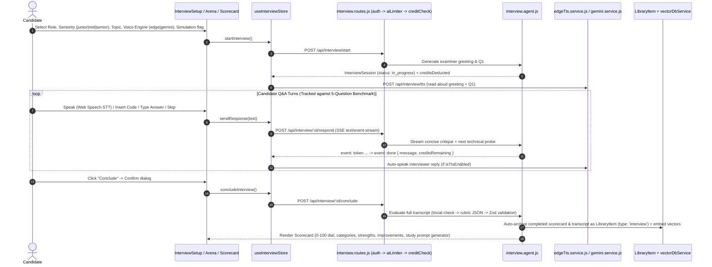
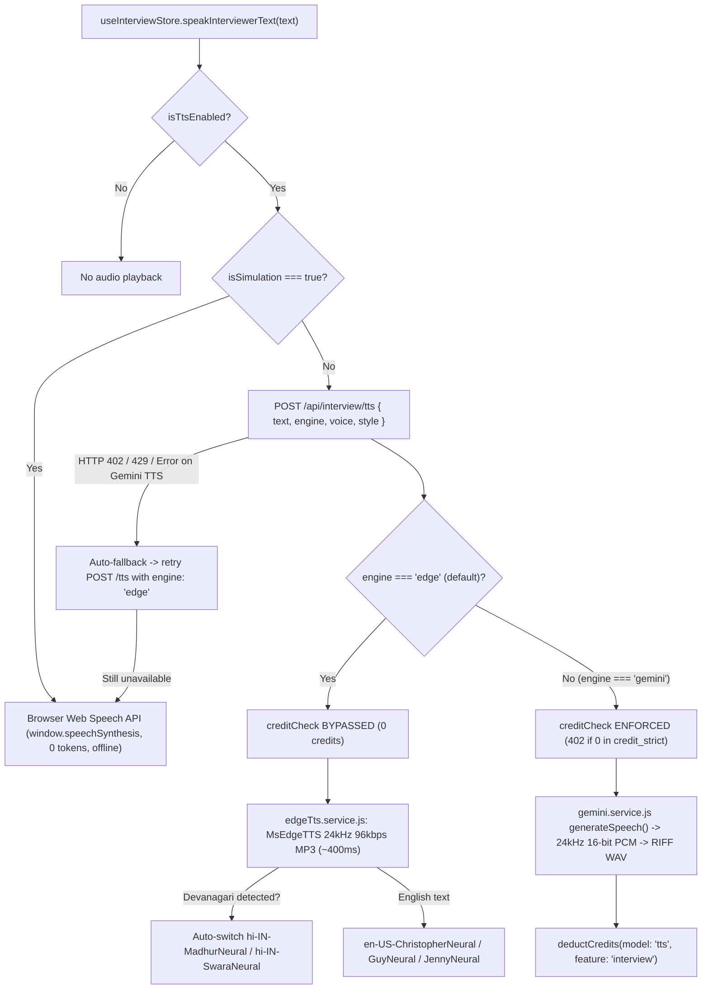

# 09 — AI Mock Interview & MSBTE Viva Platform

The **AI Mock Interview & Viva Platform** (`/interview`) provides an interactive technical and academic oral-defense simulator backed by streaming AI questioning, live Web Speech dictation, a dual-engine + 3-tier neural voice synthesizer, competency scoring, and automatic Knowledge Library archival.

---

## 1. End-to-End Mock Interview Lifecycle

---

## 2. Frontend Experience (`pages/Interview/InterviewPage.jsx` & `features/interview/`)

### 2.1 Setup Screen (`InterviewSetup.jsx`)
- **Role Presets:** `Full-Stack Engineer`, `Frontend React`, `Node.js Backend`, `System Design Architect`, `MSBTE Capstone Viva`, plus **Custom Role** input mode.
- **Seniority Calibration:** Segmented control for `junior` (`Junior / Student`), `mid` (`Mid-Level`), and `senior` (`Senior / Lead`).
- **Topic & Quick Chips:** Free-text input plus 1-click starters (`MERN APIs`, `React 19 Hooks`, `Microservices`, `MSBTE Defense`).
- **Voice Engine & Zero-Credit Simulation Toggles:** Lets users switch between `Edge Neural (Free)` (default) and `Gemini 3.8 TTS`, and toggle **Simulation Mode** (`isSimulation: true`) for 0-credit demo practice without burning quota.
- **Recent Sessions Panel:** Lists up to 5 recent interviews with score badges and average completed score, clicking directly back into the arena or completed scorecard.

### 2.2 Live Simulation Arena (`InterviewArena.jsx` & `VoiceRipple.jsx`)
- **Top Telemetry Header:** Role/difficulty badge, `Q X/5` progress bar (`BENCHMARK_QUESTIONS_TOTAL = 5`), live recording timer (`MM:SS`), estimated credit count, **Conclude** button, and **More Options** menu (switch Edge vs Gemini voice mid-session, Mute/Unmute AI voice, Copy Full Transcript, Practice New Session).
- **Examiner Panel & `VoiceRipple.jsx`:** Renders an animated 4-ring CSS scale/opacity pulse orb (`VoiceRipple`) with mini waveform bars distinguishing `interviewer`, `candidate`, and `idle` states alongside an auto-progressed `Track Topics` checklist parsed from `session.topic`.
- **Smart Question Decomposer (`parseInterviewerContent`):** Automatically splits the interviewer's turn into muted **Scenario Context** paragraphs above a highlighted **Core Question Callout Box**.
- **Earlier Turns Accordion:** Collapses prior Q&A pairs cleanly to keep focus on the active question.
- **Response Composer:** Auto-growing textarea (`Enter` submits, `Shift+Enter` newline), inline **Web Speech API** dictation button (`Mic` / `MicOff`), **Insert Code** markdown snippet helper, live word counter, **Skip** button, and **Stop Streaming** abort button. *(Architectural note: `MASTER_CHANGES_SPEC.md` `INTV-001` plans unifying `InterviewArena`'s inline `SpeechRecognition` setup onto the reusable `useSpeechRecognition` hook used by Chat.)*

### 2.3 Competency Scorecard & Study Bridge (`Scorecard.jsx`)
Displays overall score (`0–100`) and rating badge (`Strong Hire` | `Hire` | `Needs Improvement` | `Unprepared` | `Incomplete`), 4 competency bars (`Technical Accuracy`, `Problem Solving`, `Communication`, `System Design`), Lead Examiner summary, Strengths vs Areas for Improvement cards, Recommended Study Topics, **View in Library** (`/library?tab=interviews`), **Copy Report**, and **Generate Study Prompts** (auto-creates up to 3 `Prompt Vault` templates via `usePromptStore.createPrompt`!).

---

## 3. Dual-Engine + 3-Tier Fault-Tolerant Voice Architecture (`POST /api/interview/tts`)

- **SSML Safety (`edgeTts.service.js`):** Strips control characters and escapes `&`, `<`, `>`, `"`, `'` with `escapeXmlForSsml()` so technical symbols (e.g., JSX `<Component />` or `&&`) never trigger 0-byte Edge TTS stream failures.
- **WAV Framing (`gemini.service.js`):** If Gemini TTS returns raw PCM audio without a RIFF container, `createWavHeader()` prepends a standard 44-byte RIFF/WAVE PCM header (`24,000 Hz`, mono, 16-bit).

---

## 4. Trivial Session Safeguard & Simulation Engine (`interview.controller.js`)

- **Anti-Spam Incomplete Guard:** On `POST /api/interview/:id/conclude`, if the candidate sent zero substantive answers (fewer than 2 words total or no real responses), the controller skips Gemini scorecard synthesis, marks `session.status = 'incomplete'` with `rating: 'Incomplete'`, charges `0` evaluation credits, and does **not** pollute the Knowledge Library.
- **Completed Auto-Archival:** Real concluded interviews construct a full `scorecard`, embed the summary + strengths + transcript into `vectorDbService`, and persist a `LibraryItem` with `type: 'interview'`.
- **Zero-Credit Simulation Flow (`isSimulation: true`):** Allows running the entire lifecycle (`start` → multi-stage technical questions covering concurrency, load shedding, observability, distributed caching → streamed word-by-word SSE chunks → realistic mock scorecard → Library `[Simulation]` archival) without calling Gemini or spending credits.
