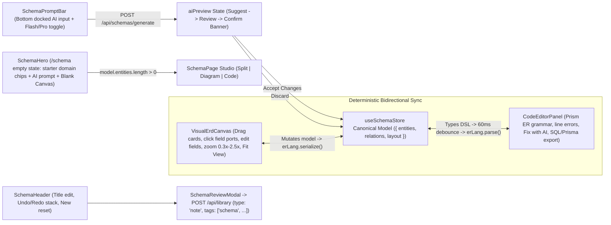

# 10 — Data Modeling & ER Diagram Studio (`/schema`)

NexAI includes a dedicated **ER Diagram Studio** (`/schema` and `/schema-designer`, implemented in `client/src/pages/Schema/SchemaPage.jsx` and `client/src/features/schemaDesigner/`) with live visual table modeling, bidirectional declarative DSL synchronization, SQL/Prisma code export, and Suggest → Review → Confirm Library archival.

Interestingly, an inspection of `client/src/features/schemaDesigner/` reveals **two distinct architectural generations** coexisting in the repository:
1. **Active UI & Eraser-Style DSL Studio (`erLang.js`):** Actively rendered by `SchemaPage.jsx` and managed by `useSchemaStore` (`schemaStore.js`).
2. **Canonical IR v1 & Linter/Seed Subsystems (`schemaIR.js`, `schemaSync.js`, `schemaLinter.js`, `schemaSeed.js`, `schemaIntent.js`):** Fully unit-tested auxiliary modules retained in `schemaDesigner/`.

---

## 1. Active ER Studio Architecture & Bidirectional Sync Flow (`erLang.js` & `schemaStore.js`)



---

## 2. Custom Eraser-Style ER Language (`client/src/features/schemaDesigner/erLang.js`)

Unlike brittle regex code parsers, the active studio stores canonical `{ entities, relations, layout }` in `useSchemaStore` and serializes cleanly between UI mutations and text using `erLang.js`:

```text
users [color: blue] {
  id uuid pk
  email string unique
  name string nullable
}

posts [color: green] {
  id uuid pk
  authorId uuid
  title string
}

posts.authorId > users.id
```

### Supported Syntax & Capabilities (`erLang.js`)
- **Entity Blocks:** `table_name [color: blue|green|purple|amber|rose|cyan] { ... }` with fields `name type [pk] [unique] [nullable]`.
- **First-Class Relationships:** Declared cleanly with four operators:
  - `>` (`many-to-one`, e.g., `posts.authorId > users.id`)
  - `<` (`one-to-many`)
  - `-` (`one-to-one`)
  - `<>` (`many-to-many`)
- **Graceful Error Tolerance:** When the user introduces a syntax error while typing in `CodeEditorPanel.jsx` (60ms debounce -> `setCode`), `parse()` returns line-numbered `errors[]` shown in the diagnostic banner (with a 1-click **Fix with AI** trigger), while `useSchemaStore` **preserves the last valid visual diagram** without crashing.
- **Undo / Redo History:** Every model or code change pushes snapshots (`_pushHistory`) capped cleanly in `history[]`, supporting `Ctrl+Z` / `Ctrl+Shift+Z` and header buttons.
- **Deterministic Exports:** `exportSQL()` generates PostgreSQL `CREATE TABLE` DDL with `PRIMARY KEY`, `UNIQUE`, `NOT NULL`, `REFERENCES ... ON DELETE ...`, and `CREATE INDEX`; `exportPrisma()` compiles clean `model ... { ... }` Prisma blocks with `@id`, `@unique`, and `@relation` directives.

---

## 3. Interactive Canvas & Code Studio UX

### 3.1 `VisualErdCanvas.jsx`
- **Orthogonal Step Routing (`svgLayer`):** Computes exact field-row Y coordinates (`headerH + fieldIdx * rowH + rowH / 2`) and card East/West X edge ports to draw crisp right-angle SVG connectors with `1` / `N` cardinality pills.
- **Click-to-Connect Ports:** Clicking a port dot on field A enters connecting mode (`Connecting from A.field -> Click target field`) and creates a typed relation (`many-to-one`, editable via floating relation popover).
- **Focus & Dimming:** Selecting an entity dims unrelated cards and unrelated relation lines so complex schemas remain readable.
- **Infinite Pan & Zoom:** Supports drag-pan background, Hand/Pointer tool switch, `Ctrl+Wheel` zoom (`0.3x–2.5x`), `Fit View` bounding-box auto-centering (snapping near `100%`), and bottom-left live table/relation/zoom counters.

### 3.2 `CodeEditorPanel.jsx`
- **Custom Prism ER Grammar (`Prism.languages.er`):** Highlights entity names, `[color: ...]`, field types (`uuid`, `string`, `int`, `decimal`, `datetime`, `boolean`, `text`, `json`, `date`, `float`), modifiers (`pk`, `unique`, `nullable`), and `table.field > target.field` relations.
- **Context-Aware Autocomplete:** Typing `tableName.` suggests that table's fields; token position 2 suggests field types; token position >= 3 suggests modifiers; column 1 outside `{}` suggests entity names for writing relationships.
- **Keyboard & Context Menu:** `Alt + ArrowDown` duplicates the current line, `Tab` inserts 2 spaces, and right-click provides Copy, Paste, and Duplicate Line actions.

---

## 4. Auxiliary Canonical IR v1 Engine (Coexisting Tested Modules)

In addition to the active Eraser DSL studio, `client/src/features/schemaDesigner/` retains tested v1 Canonical IR (`ADR-032`) modules and components:

| Module / Component | Role |
| :--- | :--- |
| **`schemaIR.js`** | Defines `version: 1` Canonical IR (`entities: Record<string, Entity>`, immutable `ent_*`/`fld_*` IDs, `field.fk`), and 6 pure projections: `generateSQL`, `generatePrisma`, `generateMongoose`, `generateTypeScript`, `generateMermaid`, `generateDBML`. |
| **`schemaLinter.js`** + `SchemaLinterDrawer.jsx` | Rule-based health scorer (`0–100`, grade `A+` to `F`) detecting missing PKs (`-15`), unindexed FKs (`-8`), missing audit timestamps, and orphan tables, with 1-click auto-fixers. |
| **`schemaSeed.js`** + `SeedDataModal.jsx` | Implements **Kahn's topological sort algorithm** over FK dependency edges so generated mock parent rows always exist before child FK references. |
| **`schemaSync.js`** | Regex/heuristic multi-dialect code-to-IR synchronization helpers (`CodeInspector.jsx`, `SchemaInspector.jsx`, `TelemetryDrawer.jsx`, `PromptPanel.jsx`, `FloatingPromptBar.jsx`). |
| **`schemaIntent.js`** | `matchSchemaIntent()` utility matching `/schema` / `/erd` slash commands or natural-language DB design prompts (unit-tested in `schemaIntent.test.js`). |

---

## 5. Backend Schema Agent & Verified Implementation Nuance

Backend `POST /api/schemas/generate` routes through `auth` → `aiLimiter` → `creditCheck` → `generateSchemaValidator` → `schema.controller.js` → `schema.agent.js` (`SCHEMA_SYSTEM_PROMPT`).

- **Verified Code Observation (`server/src/agents/schema.agent.js` lines 134–140):** `schema.agent.js` invokes `generateContent({ prompt: userContent, systemInstruction: SCHEMA_SYSTEM_PROMPT, model, temperature: 0.2, responseMimeType: 'application/json' })`, whereas `gemini.service.js`'s `generateContent` destructures `{ contents, model, systemInstruction, config }` and forwards `contents` to `@google/genai`.
- **Runtime Effect:** Because `contents` is `undefined`, live Gemini calls inside `schema.agent.js` throw inside its `try/catch` block, log a warning, and gracefully fall back to `getSimulatedErCode(prompt)` (`tokensUsed: 0`, `creditsDeducted: 0`, `isSimulated: true`), returning valid Eraser DSL covering common domains (`e-commerce`, `SaaS`, `social`, or generic user schema). Running with `isSimulation: true` uses the exact same deterministic generator explicitly.
