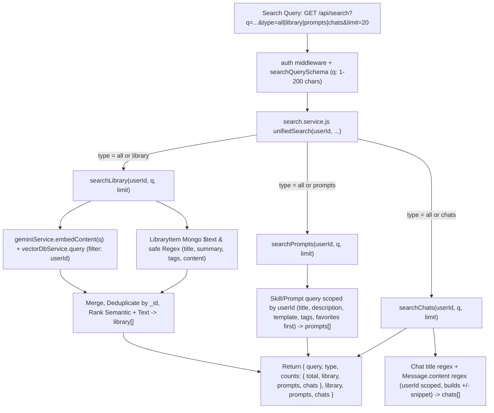

# 11 — Unified Hybrid Search & Command Palette (`Ctrl+K`)

Users store context in three different places: **Knowledge Library items**, **Prompt Vault templates**, and **Chat threads/messages**. NexAI connects all three via a single **Hybrid Search Engine** (`GET /api/search`) and surfaces results both on `/search` (`SearchPage.jsx`) and inside a global keyboard **Command Palette (`Ctrl+K` / `Cmd+K`)**.

---

## 1. Cross-Domain Hybrid Search Pipeline (`search.service.js`)

### Multi-Tenant Scoping & Security Details
- **Zero Data Leakage:** `searchLibrary` injects `{ userId: String(userId) }` into vector queries and verifies MongoDB ownership (`LibraryItem.find({ _id: { $in }, userId })`). `searchChats` first resolves `userChatIds` owned by `userId` before scanning `Message.content`.
- **Safe Regex Escaping (`escapeRegex`):** Special regex characters in user search strings are escaped before building case-insensitive MongoDB `$regex` fallback queries, preventing ReDoS or invalid pattern crashes.
- **Snippet Extraction:** When a match comes from inside a `Message.content`, `searchChats` slices a contextual preview around the matched keyword and annotates `{ matchType: 'message', role, snippet, chatId }`.

---

## 2. Dedicated Workspace Search Page (`/search`, `SearchPage.jsx`)

Managed by `useSearchStore` (`searchStore.js`):
- **Instant Default Workspace View:** When `q` is empty, `/search` displays the user's conversation history with a **Cards Grid vs Compact List** toggle, inline single-chat rename/delete actions, and multi-select checkboxes + floating bulk-delete toolbar (`useChatStore.deleteMultipleChats`).
- **Debounced Live Categorized Results (`useDebounce`):** Entering a query triggers `GET /api/search` and shows counts across 4 category tabs (`All`, `Library`, `Prompts`, `Chats`). Clicking any card navigates directly to that conversation (`/chat/:chatId`), library item detail view (`/library`), or prompt template (`/prompts`).
- **Recent Search History:** Caches recent search strings locally in `localStorage` (`nexai_recent_searches`), rendered as clickable chips with individual remove (`X`) and **Clear All** controls.

---

## 3. Global Command Palette (`Ctrl+K` / `Cmd+K` — `CommandPalette.jsx`)

Mounted inside `AppLayout.jsx` (`window` keydown listener via `useHotkey`), `CommandPalette` blends zero-latency frontend navigation with debounced hybrid backend search:

1. **Navigation & Action Commands (Zero Backend Latency):**
   - Route jumps: `New Chat / Home`, `Project Workspaces`, `Knowledge Library`, `AI Mock Interview`, `Prompt Vault`, `ER Diagram Studio`, `Search`, `Wallet & Billing`, `Settings & Memory`, `Design System`, and `Admin Analytics` (shown only when `user?.role === 'admin'`).
   - Instant actions: **New Chat**, **Toggle Theme (Dark/Light)**, **Toggle Sidebar**, **Open Settings**.
2. **250ms Debounced Live Backend Search:**
   - When the user types a non-empty query in the palette, `CommandPalette` cancels any in-flight timers and runs `/api/search?q=...&limit=5` to list matching **Conversations**, **Library Items**, and **Prompt Templates** directly under command groups.
3. **Full Keyboard Control:** `ArrowDown` / `ArrowUp` cycle selection across filtered groups, `Enter` executes the highlighted route/action or opens the matched item, and `Escape` dismisses the overlay.
