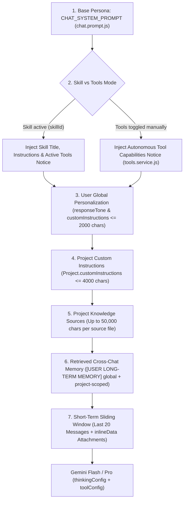

# 13 — AI Prompts, Agents, Simulator & Workspace Rules

NexAI contains zero opaque prompt frameworks like LangChain—every LLM call is explicitly crafted using **6 modular system-prompt files** (`server/src/agents/prompts/*.js`) driving **5 specialized backend agents** (`server/src/agents/*.agent.js`), curated starter templates (`starterPrompts.js`), offline simulators (`chatSimulator.js`), and strict repository governance rules (`.agents/rules/nexaiworkspace.md`).

---

## 1. Chat Agent Context Assembly Order (`chat.agent.js`)

For every conversational turn, `streamChatReply()` composes a layered `systemInstruction` before streaming via `@google/genai`:



---

## 2. Backend AI Agents & Prompts Inventory

### 2.1 Chat & Auto-Title (`chat.prompt.js` & `chat.agent.js`)
- **`CHAT_SYSTEM_PROMPT`:** Instructs Gemini to format clean GitHub Flavored Markdown, include proper language tags on code blocks, output `mermaid` blocks for architectures/workflows/schemas/sequences, emit valid multi-line Markdown tables (avoiding `||` row separators), wrap prompt templates in fenced ````prompt ... ```` blocks with `{{variable}}` syntax, and honor both short-term dialogue history and `[USER LONG-TERM MEMORY]` facts across English, Hindi, Hinglish, and other languages. *(Note: `docs/MASTER_CHANGES_SPEC.md` `AI-001`/`AI-002` proposed restricting diagrams to explicit requests, whereas the live prompt file encourages Mermaid diagrams for architectural explanations.)*
- **`TITLE_SYSTEM_PROMPT`:** Summarizes the user's opening message into a concise **3–6 word title** without quotes, `"Title:"` prefixes, emojis, or trailing punctuation (`generateContent`, metered via `deductCredits`).

### 2.2 Document Generator (`docGen.prompt.js` & `docGen.agent.js`)
- **Categories:** `'resume'`, `'report'`, `'spec'`, `'notes'`, `'other'`.
- **Output Contract (`temperature: 0.3`, `responseMimeType: 'application/json'`):** Enforces 3–7 substantial markdown sections (`{ title, category, summary, sections: [{ heading, body }] }`), stripped of accidental fences (`parseJsonOutput`) and validated with Zod `docGenOutputSchema`.
- **Resilience:** On parse/API failure, returns a safe 3-section fallback template (`Overview`, `Details & Analysis`, `Action Items & Next Steps`) with `tokensUsed: 0`.

### 2.3 Mock Interview & Evaluation Rubric (`interview.prompt.js` & `interview.agent.js`)
- **`INTERVIEWER_SYSTEM_PROMPT`:** Dynamically calibrates rigor to seniority:
  - *Junior / Student:* fundamentals, mental models, conventions.
  - *Mid-Level:* engineering trade-offs, edge cases, API design, error resilience.
  - *Senior / Lead:* distributed scale, latency vs throughput, fault tolerance, data consistency.
  - *MSBTE Capstone Viva:* database normalization, authentication/security, viva defense justification.
  - Turn cadence: concise 2–4 paragraphs combining targeted critique with the next technical follow-up.
- **`SCORECARD_SYSTEM_PROMPT` (`temperature: 0.2`, JSON mode -> Zod `scorecardOutputSchema`):** Evaluates full transcript across 4 metrics (`technicalAccuracy`, `problemSolving`, `communication`, `systemDesign`) and assigns official rating tiers:
  - `85–100`: **Strong Hire**
  - `70–84`: **Hire**
  - `50–69`: **Needs Improvement**
  - `0–49`: **Unprepared** *(plus `'Incomplete'` when trivial check fires in `interview.controller.js`)*

### 2.4 Memory Extraction & Reconciliation (`memory.prompt.js` & `memory.service.js`)
- **`MEMORY_EXTRACTION_PROMPT`:** Instructs Gemini Flash to extract durable third-person facts (`memories[]`) and explicit erasure requests (`forgetRequests[]`) in JSON across 5 categories (`identity`, `preference`, `project`, `instruction`, `fact`), explicitly teaching Hindi/Hinglish recognition (e.g., `"mera naam shivam hai save kar lo ok"`, `"yaad rakhna ki main Pune se hoon"` -> English third-person `"User's name is Shivam"`). Filters ephemeral Q&A and small talk.
- **`MEMORY_DECISION_PROMPT`:** Evaluates newly extracted candidates against vector-matched active memories, returning structured decisions:
  - `ADD`: non-overlapping new fact
  - `UPDATE`: evolves or contradicts an existing memory (assigns semantic slot key e.g. `user.location`, sets `targetMemoryId`, triggers temporal superseding)
  - `DELETE`: fulfills explicit user forget request
  - `NONE`: semantic duplicate or noise

### 2.5 Categorization & Multimodal File/URL Tagging (`tagging.prompt.js` & `tagging.agent.js`)
- **`TAGGING_SYSTEM_PROMPT` (`temperature: 0.2`, JSON mode -> `taggingOutputSchema`):** Produces `{ title (<=100 chars), summary (2–3 sentences avoiding "This article is about..."), tags (3–5 specific 1–2 word lowercase hyphenated tags) }`.
- **Multimodal Part Injection:** Supports optional `inlineData` (`fileBase64` + `mimeType`) so uploaded PDFs and images are comprehended directly by Gemini Flash.
- **Post-Processing Guard (`normalizeTags`):** Rejects generic metadata words (`interview`, `mid`, `junior`, `senior`, `document`, `note`, `link`, `file`, `info`, `text`), splits multi-word phrases, and guarantees at least 3 clean tags.

### 2.6 Database & ER Schema Prompt (`schema.prompt.js` & `schema.agent.js`)
- **`SCHEMA_SYSTEM_PROMPT`:** Instructs Gemini to output `{ code, summary }` JSON in NexAI's Eraser-style ER syntax (`entity [color: ...] { field type [pk] [unique] [nullable] }` + `a.b > c.d` relations) and preserve existing tables when refining schemas. *(See [Page 10](./10-Data-Modeling-and-Schema-Designer.md) for the config parameter mismatch in `schema.agent.js` causing fallback to `getSimulatedErCode()`.)*

---

## 3. Built-In Client Prompt Catalogs & Deterministic Simulator

- **Prompt Vault Starters (`client/src/constants/starterPrompts.js`):** 8 developer templates across 4 categories (`development`, `architecture`, `debugging`, `documentation`):
  1. `Senior Code Reviewer` (`{{language}}`, `{{code}}`, `{{focus_areas}}`)
  2. `Refactoring & Clean Code Specialist` (`{{language}}`, `{{code}}`, `{{constraints}}`)
  3. `Comprehensive Unit & Edge Case Suite` (`{{test_framework}}`, `{{code_under_test}}`)
  4. `System Architecture & Design Spec` (`{{system_name}}`, `{{requirements}}`, `{{scale_and_traffic}}`)
  5. `SQL Query & Index Optimizer` (`{{database_dialect}}`, `{{schema_context}}`, `{{slow_query}}`)
  6. `Bug Root Cause Analysis & Fix` (`{{error_or_stacktrace}}`, `{{relevant_code}}`, `{{environment_details}}`)
  7. `Security Vulnerability & OWASP Audit` (`{{framework_stack}}`, `{{code_to_audit}}`)
  8. `API Endpoint Documentation Drafter` (`{{endpoint_method_and_path}}`, `{{handler_or_controller_code}}`)
- **System & Recommended Skills:** 4 seeded system skills (`skill.service.js`, with a 5th schema-drafted ERD skill skipped by validation) + 6 recommended UI presets (`SkillsTab.jsx`).
- **Offline Simulation Engine (`server/src/utils/chatSimulator.js`):** 905-line deterministic simulator exporting `streamChatSimulation`, `getSimulatedChatContent`, and `getSimulatedThinkingProcess` so demos and automated streaming verification run with `0` external API tokens.

---

## 4. Workspace Agent Rules (`.agents/rules/nexaiworkspace.md`) & Engineering Docs

AI coding assistants operating inside this workspace follow `.agents/rules/nexaiworkspace.md`:
1. **`docs/PRD.md` & `docs/BUILD_GUIDE.md`** act as sources of truth (`PRD` for scope, `BUILD_GUIDE` for conventions, `docs/decisions.md` logging trade-offs across **ADR-001 through ADR-034**).
2. **Locked Stack:** No Tailwind/MUI/Chakra on the client; no LangChain on the server; model names strictly from `.env`.
3. **Billing & Safety Invariants:** Every AI call uses `creditCheck` + `ceil(totalTokens / 100)` (`credit.service.js`); every DB mutation of AI output follows **Suggest → Review → Confirm**; every query filters strictly by `userId`.
4. **Git & Quality Gates:** `feature/*` branches off `dev` (merged `--no-ff`), Conventional Commits, ESLint + Vitest verification before merging.
