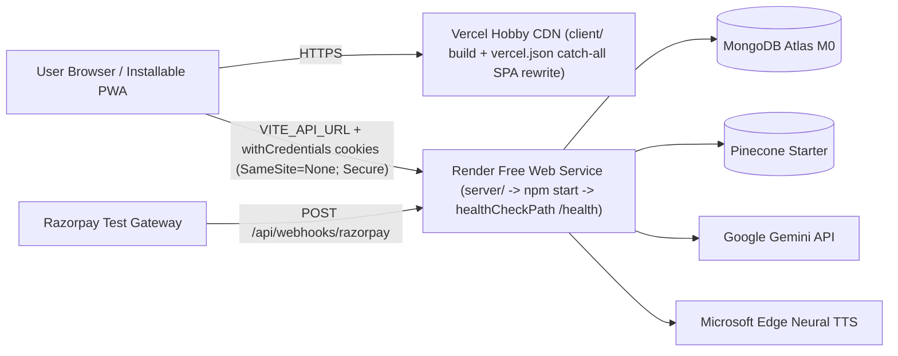

# 14 — Complete API Reference, Test Suite Inventory, Deployment & Audit

This page serves as the authoritative technical reference for NexAI's **18 server route modules**, **70 automated test suites (434 verified test cases)**, code quality configuration, cloud deployment (`render.yaml` + `vercel.json`), MSBTE seminar artifacts, and verified codebase-vs-documentation discrepancies.

---

## 1. Exhaustive Backend REST & SSE Endpoint Catalog (`server/src/routes/`)

All routes below mount under `/api` (with `/health` and `/webhooks/razorpay` also aliased at root in `app.js`).

| Domain | Method & Path | Middlewares | Handler & Response |
| :--- | :--- | :--- | :--- |
| **Health** | `GET /api/health` (and `/health`) | Public | `getHealth` (`200 ok` / `503 degraded` via `isDbConnected()`) |
| **Auth** | `POST /api/auth/register` | `authLimiter` (30/15m), `validate` | `register` -> `201` `{ user, accessToken }` + `httpOnly` cookie |
| **Auth** | `POST /api/auth/login` | `authLimiter`, `validate` | `login` -> `200` `{ user, accessToken }` + `httpOnly` cookie |
| **Auth** | `POST /api/auth/google` | `authLimiter`, `validate` | `googleLogin` (`google-auth-library` verify) |
| **Auth** | `POST /api/auth/refresh` | Cookie `refreshToken` | `refresh` -> rotates access token |
| **Auth** | `POST /api/auth/logout` | Public | `logout` -> clears refresh cookie |
| **Auth** | `GET /api/auth/me` | `auth` | `getMe` -> current sanitized `User` |
| **Users** | `PATCH /api/users/me/settings` | `auth`, `validate` | `updateSettings` (`theme`, `defaultModel`, `webSearchDefaultOn`, `personalization`) |
| **Chat** | `GET /api/chats` | `auth` | `getChats` (optional `?projectId=`) |
| **Chat** | `POST /api/chats` | `auth`, `validate` | `createChat` (`title?`, `projectId?`, `isTemporary?`) |
| **Chat** | `PATCH /api/chats/:id` | `auth`, `validate` | `updateChat` (`title?`, `projectId?`, `pinned?`) |
| **Chat** | `DELETE /api/chats/:id` | `auth`, `validate` | `deleteChat` (cascades `Message` docs) |
| **Chat** | `GET /api/chats/:id/messages` | `auth`, `validate` | `getMessages` chronological history |
| **Chat** | `POST /api/chats/:id/messages` | `auth`, `aiLimiter` (30/1m), `validate`, `creditCheck` | `sendMessage` -> **SSE stream** (`step`, `grounding`, `thought`, `token`, `memory_updated`, `done`, `error`) |
| **Library** | `POST /api/library/suggest` | `auth`, `aiLimiter`, `creditCheck`, `validate` | `suggestItem` (URL/note/base64 PDF-image -> draft metadata only) |
| **Library** | `POST /api/library/documents/generate` | `auth`, `aiLimiter`, `creditCheck`, `validate` | `generateDocument` (structured draft without DB write) |
| **Library** | `GET /api/library/documents/:id/export.pdf` | `auth` | `exportDocumentPdf` (`pdf-lib` binary `application/pdf` stream) |
| **Library** | `GET /api/library` / `POST /api/library` | `auth`, `validate` | `listItems` (`type`, `tab`, `tag`, `pinned`, sort, page) / `createItem` (+ multi-chunk vectors) |
| **Library** | `GET /api/library/search` | `auth`, `validate` | `searchItems` (vector + Mongo `$text` hybrid search) |
| **Library** | `GET`, `PATCH`, `DELETE /api/library/:id` | `auth`, (`validate` on `PATCH`) | `getItemById`, `updateItem` (re-indexes vectors on change), `deleteItem` (purges vectors) |
| **Projects** | `GET`, `POST /api/projects` | `auth`, `validate` | `getProjects` (with chat counts), `createProject` |
| **Projects** | `GET`, `PATCH`, `DELETE /api/projects/:id` | `auth`, `validate` | `getProjectById`, `updateProject`, `deleteProject` (unlinks chats safely) |
| **Projects** | `POST /api/projects/:id/sources` / `DELETE .../:sourceId` | `auth`, `validate` | `addProjectSource`, `deleteProjectSource` |
| **Prompts** | `GET`, `POST /api/prompts` & `GET`, `PATCH`, `DELETE /:id` | `auth`, `validate` | Stored in shared `skills` collection via `Prompt = Skill`; auto-extracts `{{vars}}` |
| **Skills** | `GET`, `POST /api/skills` & `GET`, `PATCH`, `DELETE /:id` | `auth`, `validate` | `getSkills` (`category`, `tool`, `favorite`), CRUD on user skills |
| **Skills** | `POST /api/skills/:id/favorite` | `auth`, `validate` | `toggleFavorite` |
| **Schedules** | `GET`, `POST /api/schedules` & `GET`, `PATCH`, `DELETE /:id` | `auth`, `validate` | Recurring/once automation CRUD |
| **Schedules** | `PATCH /api/schedules/:id/toggle` / `POST .../run-now` | `auth`, `validate` | Toggle `isActive` / instant execution & metering |
| **Connected Apps** | `GET /api/connected-apps` / `PATCH /api/connected-apps/:slug` | `auth` | Auto-seeds 5 app integrations (`web-search`, `github`, `google-drive`, `notion`, `figma`) & updates creds |
| **Interview** | `GET /api/interview` / `GET /api/interview/:id` | `auth`, (`validate`) | `getInterviews`, `getInterviewById` |
| **Interview** | `POST /api/interview/start` | `auth`, `aiLimiter`, `creditCheck`, `validate` | `startInterview` -> opening greeting & Q1 (`isSimulation` supported) |
| **Interview** | `POST /api/interview/:id/respond` | `auth`, `aiLimiter`, `creditCheck`, `validate` | `respondInterview` -> **SSE stream** critique & next question |
| **Interview** | `POST /api/interview/:id/conclude` | `auth`, `aiLimiter`, `creditCheck`, `validate` | `concludeInterview` -> scorecard evaluation + Library archival |
| **Interview** | `POST /api/interview/tts` | `auth`, `aiLimiter`, `creditCheck`, `validate` | `synthesizeInterviewSpeech` (`edge` 0-credit MP3 / `gemini` WAV / `204` simulation) |
| **Memories** | `GET`, `POST`, `DELETE /api/memories` | `auth`, (`validate`) | `getMemories`, `createMemory`, `clearMemories` |
| **Memories** | `PATCH`, `DELETE /api/memories/:id` | `auth`, `validate` | `updateMemory`, `deleteMemory` |
| **Memories** | `POST /api/memories/consolidate` | `auth` | `consolidateMemories` (AI memory cleanup/merge) |
| **Schema** | `POST /api/schemas/generate` | `auth`, `aiLimiter`, `creditCheck`, `validate` | `generateSchema` (`prompt`, `currentCode`, `model`, `isSimulation`) |
| **Search** | `GET /api/search` | `auth`, `validate` | `searchAll` (`q`, `type`, `limit`) across Library, Prompts, Chats |
| **Wallet** | `GET /api/wallet` / `PATCH /api/wallet/mode` / `GET /api/wallet/plans` | `auth`, (`validate`) | Balance + governance telemetry, toggle mode, server `PLANS` |
| **Wallet** | `POST /api/wallet/orders` / `POST /api/wallet/verify` / `GET /api/wallet/transactions` | `auth`, (`validate`) | Create Razorpay order, HMAC verification, paginated ledger |
| **Webhooks** | `POST /api/webhooks/razorpay` (and `/webhooks/razorpay`) | Public (`express.raw`) | `handleRazorpayWebhook` (`X-Razorpay-Signature` HMAC + idempotent credit) |
| **Admin** | `GET /api/admin/stats`, `/usage`, `/transactions`, `/errors`, `/config` & `PATCH /config` | `auth`, `requireRole('admin')`, (`validate`) | KPIs, time-series, transactions, `ErrorLog`s, dual-mode governance config |

---

## 2. Automated Test Suite Inventory (Verified Static Count)

Both workspaces use **Vitest** (`^3.0.4`), paired with **Supertest** (`^7.0.0`) on the server and **React Testing Library + jsdom** on the client. Static analysis of all test files confirms **70 test files containing 434 `it()` / `test()` cases**:

### 2.1 Backend Test Suites (`server/tests/` — 18 files, 189 cases)
| Test File | Cases | Coverage Focus |
| :--- | :---: | :--- |
| `interview.test.js` | 18 | Auth isolation, start/respond SSE/conclude, incomplete guard, simulation mode, Edge & Gemini TTS |
| `chat.test.js` | 14 | Chat CRUD, ownership 404s, SSE token streaming, `402` balance lock, simulation streaming |
| `prompt.test.js` | 14 | `{{var}}` whitespace trimming & deduplication, CRUD, tenant isolation, favorite sorting |
| `auth.test.js` | 13 | Register starter credits, duplicate email `409`, login, refresh cookie, `/me`, settings, RBAC `403`/`200` |
| `skills.test.js` | 13 | System skills seeder, category/tool filters, custom CRUD, Gemini tool declarations, bot-filter relevance |
| `library.test.js` | 12 | `suggest` (incl. PDF base64), multi-chunk vector indexing, CRUD, semantic search |
| `memory.test.js` | 12 | Memory CRUD, Hinglish/English extraction, `aiMemoryEnabled: false`, consolidation, settings update |
| `credit.test.js` | 11 | `tokensToCredits` ceiling math, `assertBalance`, atomic `deductCredits` floor clamping, `creditCheck` |
| `quotaGovernance.test.js` | 11 | `SystemConfig`, `quota_free` vs `credit_strict` `402`/`429`, `/api/admin/config`, `/api/wallet` governance |
| `wallet.test.js` | 11 | Plan authority, HMAC verification, raw-body webhook verification, **concurrent verify+webhook idempotency** |
| `project.test.js` | 10 | Project CRUD, safe chat unlinking on delete, moving chats, local file source upload/delete |
| `search.test.js` | 10 | Cross-domain unified search, category tabs, message snippet extraction, strict `userId` isolation |
| `admin.test.js` | 8 | Admin RBAC (`401`/`403`/`200`), KPI & revenue aggregation, `7d`/`30d` series, paginated errors & txns |
| `e2e.journey.test.js` | 8 | Full user journey: Register -> Wallet -> Chat SSE -> Library -> Interview -> Recharge -> Admin -> 402 gate |
| `schedule.test.js` | 8 | Schedule CRUD, toggle, immediate `run-now` execution + credit deduction, Connected Apps init & update |
| `memory.overhaul.test.js` | 7 | Cosine threshold cutoff, telemetry (`lastUsedAt`/`useCount`), project scope isolation, credential guard, temporal flags |
| `docGen.test.js` | 6 | `docGen` JSON validation, `402` block, non-persistence draft contract, `pdf-lib` PDF export headers |
| `health.test.js` | 3 | `503 degraded` when DB disconnected, `200 ok` when connected, normalized `404` |

### 2.2 Frontend Test Suites (`client/src/**/*.test.*` — 52 files, 245 cases)
- **Zustand Stores (11 files, 62 cases):** `chatStore.test.js` (15), `libraryStore.test.js` (9), `schemaStore.test.js` (6), `interviewStore.test.js` (5), `promptStore.test.js` (5), `searchStore.test.js` (5), `adminStore.test.js` (4), `projectStore.test.js` (4), `authStore.test.js` (3), `skillStore.test.js` (3), `uiStore.test.js` (3).
- **Schema Designer Engine (5 files, 21 cases):** `erLang.test.js` (5), `schemaIR.test.js` (6), `schemaIntent.test.js` (4), `schemaLinter.test.js` (4), `schemaSeed.test.js` (2).
- **Chat, Markdown & Voice Components (9 files, 48 cases):** `ChatHero.test.jsx` (13), `MermaidBlock.test.jsx` (6), `MessageAttachments.test.jsx` (6), `InlineThinking.test.jsx` (5), `MarkdownRenderer.test.jsx` (4), `AgentStepTimeline.test.jsx` (4), `PromptBlock.test.jsx` (4), `AttachmentLightbox.test.jsx` (3), `useSpeechRecognition.test.js` (5 — under `hooks/`) & `speechSynthesis.test.js` (6 — under `lib/utils/`).
- **Wallet, Admin, Interview, Library, Skills, Memory, Navigation (25 files):** Covers `Sidebar.test.jsx` (7), `Topbar.test.jsx` (7), `sse.test.js` (11), `SearchPage.test.jsx` (9), `MemoryManager.test.jsx` (6), `PromptsPage.test.jsx` (5), `SlashSkillsPopover.test.jsx` (5), `CommandPalette.test.jsx` (4), `VariableFillModal.test.jsx` (4), `DocGeneratorModal.test.jsx` (4), `InterviewSetup.test.jsx` (4), `QuotaTelemetryCard.test.jsx` (4), `TransactionTable.test.jsx` (4), `AdminRoute.test.jsx` (3), `ProtectedRoute.test.jsx` (2), plus UI primitive tests (`Button`, `NexAiLogo`, `VoiceRipple`, `SaveItemModal`, `PlanCard`, `RazorpayPaymentModal`, `TransactionReceiptModal`, `CreditBadge`, `StatCard`, `ErrorLogsTable`, `RecentTransactionsTable`).

---

## 3. Cloud Deployment Architecture (`render.yaml` & `client/vercel.json`)

- **Backend (`render.yaml`):** `rootDir: server`, `buildCommand: npm install`, `startCommand: npm start`, `plan: free`, `healthCheckPath: /health`, `autoDeploy: true`. Note the known Render free-tier spin-down cold start (~30–60s after idle).
- **Frontend (`client/vercel.json`):** Rewrites `/(.*)` → `/index.html` so React Router deep links (`/chat/:id`, `/projects/:id`, `/library`) resolve cleanly on refresh.
- **Database Seeding (`server/src/scripts/`):** `seedAdmin.js` creates or elevates `ADMIN_EMAIL` with hashed `ADMIN_PASSWORD` (`npm run seed:admin --workspace=server`); `testE2EStreaming.js` provides a standalone SSE streaming CLI harness.

---

## 4. Seminar & Academic Presentation Tooling

To support MSBTE Course **315003** ("Seminar and Project Initiation Course"), the repository also maintains:
- **`docs/ABSTRACT.md` & `docs/ABSTRACT.html`:** Print-optimized A4 single-page executive abstract with rich-text copy-to-Docs helper.
- **`docs/viva-prep.md`:** Top 10 technical defense questions (e.g., *"Why isn't this an AI wrapper?"*, *"SSE vs WebSockets"*, *"Atomic concurrency"*).
- **`docs/SEMINAR_PRESENTATION_GUIDE.md` & `docs/nexai_presentation_prompt.md`:** Master 15-slide blueprint enforcing MSBTE Times New Roman & justified-paragraph guidelines.
- **`build_seminar_presentation.py` (1,188 lines) -> `NexAI_Seminar_Presentation.pptx` & `presentation.html`:** Programmatic PowerPoint + interactive browser deck generator matching the 15-slide limit.

---

## 5. Consolidated Codebase Audit: Subtle Implementation Nuances

Inspecting the actual source files (rather than trusting planning docs alone) surfaced several concrete implementation details to keep in mind during future work or upgrades:

1. **`/skills` & `/automations` Unmounted Routes:** `ROUTES.SKILLS` and `ROUTES.AUTOMATIONS`, `Sidebar` nav links, `SkillsPage.jsx`, and `AutomationsPage.jsx` all exist, and backend APIs + the 60s `scheduleRunner` run cleanly—yet `client/src/router/index.jsx` does not currently declare `<Route path={ROUTES.SKILLS} ...>` or `<Route path={ROUTES.AUTOMATIONS} ...>` inside `appChildren`, causing direct navigation to land on `NotFoundPage`.
2. **`schema.agent.js` Parameter Mismatch:** Calls `generateContent({ prompt, temperature, responseMimeType })` instead of `{ contents, model, systemInstruction, config }`, causing live `/api/schemas/generate` calls to fall back cleanly to `getSimulatedErCode(prompt)` at 0 tokens.
3. **`Document` vs `LibraryItem` Legacy References:** `schedule.service.js` writes `Document.create({ ..., type: 'document', content })` when `deliveryTarget === 'library'` (though `Document.js` defines `sections`, and the Library UI displays `LibraryItem`), and `tools.service.js` `workspace_search` queries `Document` on `'sections.content'` instead of `'sections.body'`.
4. **System Skill Seeder Validation:** `skill.service.js` includes `'database-erd-architect'` with `category: 'Architecture'` and `tools: ['schema_modeling']`, which fall outside `Skill.js`'s enum validation lists.
5. **`SettingsPage` `toolExecutionMode` Persistence Gap:** `User.js`, `user.validator.js`, and `SettingsPage.jsx` expose `toolExecutionMode`, whereas `user.controller.js` (`updateSettings`) only forwards `{ theme, defaultModel, webSearchDefaultOn, personalization }`.
6. **Model Effort Levels Mapping:** `chatStore.js` defines UI effort constants including `'extra'` and `'max'`, while `chat.validator.js` accepts `['off', 'low', 'medium', 'high']` (the active `ModelSelectorModal` & `ModelSelectorPopover` controls respect `off..high`).
7. **PDF Export Blob Unwrapping (`client/src/lib/api/library.api.js`):** `apiClient`'s interceptor already returns `response.data`, while `exportDocumentPdf` accesses `response.data` again before constructing `new Blob([response.data])`—worth validating on live document PDF downloads.
8. **Environment Fallback Mismatch (`gemini.service.js` vs `env.js`):** `gemini.service.js` internal helper defaults fall back to `'gemini-3.1-flash-lite'` and `'text-embedding-004'` if `env` keys were blank, whereas `env.js` defaults populate `'gemini-3.5-flash-lite'` and `'gemini-embedding-001'`.
